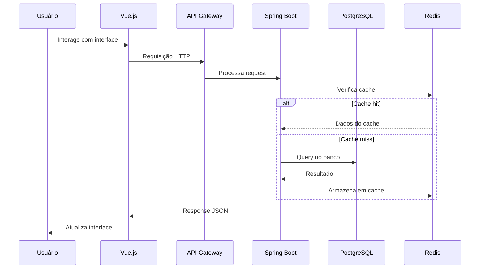
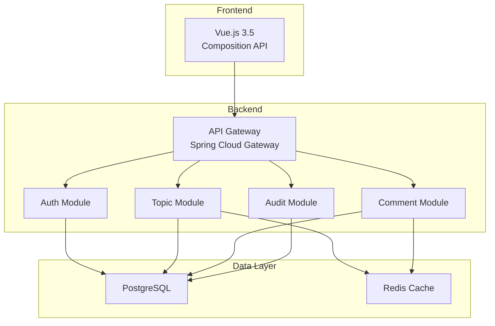
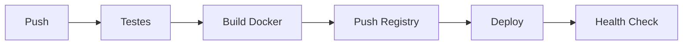

# Forum Hub


O **Forum Hub** é uma plataforma full-stack de fórum para troca de conhecimento com arquitetura de monolito modular. Backend em Java 17 com Spring Boot 3.4.1 incluindo sistema de auditoria avançada com snapshots de dados excluídos, cache Redis L2 e UUIDs binários.

## Índice

- [Visão Geral](#visão-geral)
- [Arquitetura de Software](#arquitetura-de-software)
- [Estrutura de Pastas](#estrutura-de-pastas)
- [Módulos e Responsabilidades](#módulos-e-responsabilidades)
- [Telas e Fluxo](#telas-e-fluxo)
- [Regras de Negócio](#regras-de-negócio)
- [Requisitos Funcionais](#requisitos-funcionais)
- [Requisitos Não Funcionais](#requisitos-não-funcionais)
- [Testes Automatizados](#testes-automatizados)
- [CI/CD](#cicd)
- [Contribuição](#contribuição)

## Visão Geral

O Forum Hub é uma plataforma completa de fórum para discussão e compartilhamento de conhecimento. A aplicação utiliza arquitetura de monolito modular com Spring Boot, permitindo escalabilidade horizontal e manutenção facilitada.

### Características Principais

- **Arquitetura Modular**: Separação clara de domínios
- **Auditoria Avançada**: Sistema completo de rastreamento de alterações
- **Cache Redis**: Performance otimizada com cache L2
- **UUIDs Binários**: Identificadores únicos eficientes em armazenamento
- **Frontend Moderno**: Vue.js 3.5 com Composition API

### Fluxo do Sistema



## Arquitetura de Software

A arquitetura é baseada em monolito modular com camadas bem definidas:

- **Presentation**: Vue.js 3.5 (Frontend)
- **API**: Spring Boot REST API
- **Business**: Lógica de negócio por módulo
- **Persistence**: Spring Data JPA + PostgreSQL
- **Cache**: Redis L2

### Diagrama de Arquitetura



## Estrutura de Pastas

```
forum-hub/
├── backend/
│   ├── src/
│   │   ├── main/
│   │   │   ├── java/com/forumhub/
│   │   │   │   ├── auth/
│   │   │   │   │   ├── controller/
│   │   │   │   │   ├── service/
│   │   │   │   │   ├── repository/
│   │   │   │   │   └── model/
│   │   │   │   ├── topic/
│   │   │   │   │   ├── controller/
│   │   │   │   │   ├── service/
│   │   │   │   │   ├── repository/
│   │   │   │   │   └── model/
│   │   │   │   ├── comment/
│   │   │   │   │   ├── controller/
│   │   │   │   │   ├── service/
│   │   │   │   │   ├── repository/
│   │   │   │   │   └── model/
│   │   │   │   ├── audit/
│   │   │   │   │   ├── interceptor/
│   │   │   │   │   ├── repository/
│   │   │   │   │   └── model/
│   │   │   │   └── config/
│   │   │   └── resources/
│   │   │       ├── application.yml
│   │   │       └── db/migration/
│   │   └── test/
│   └── pom.xml
├── frontend/
│   ├── src/
│   │   ├── components/
│   │   ├── views/
│   │   ├── composables/
│   │   └── stores/
│   ├── public/
│   └── package.json
├── docker-compose.yml
└── README.md
```

## Módulos e Responsabilidades

| Módulo | Responsabilidade | Tecnologia |
|--------|------------------|------------|
| Auth | Autenticação e autorização | Spring Security, JWT |
| Topic | Gerenciamento de tópicos | Spring Boot, JPA |
| Comment | Gerenciamento de comentários | Spring Boot, JPA |
| Audit | Auditoria de alterações | Spring AOP, Hibernate Envers |

### Sistema de Auditoria

O sistema de auditoria captura:

| Evento | Dados Armazenados |
|--------|-------------------|
| Criação | Snapshot completo do objeto |
| Atualização | Dados antes e depois |
| Exclusão | Snapshot antes da exclusão |
| Acesso | IP, timestamp, usuário |

## Telas e Fluxo

### Interface do Fórum

A interface apresenta:
- Lista de tópicos com filtros
- Visualização de tópico com comentários
- Sistema de likes e dislikes
- Perfil do usuário

### Fluxo de Criação de Tópico

```mermaid
flowchart TD
    A[Usuário clica "Novo Tópico"] --> B[Preenche título e corpo]
    B --> C[Seleciona tags]
    C --> D[Envia para API]
    D --> E{Dados válidos?}
    E -->|Sim| F[Salva no banco]
    E -->|Não| G[Retorna erro]
    F --> H[Invalida cache]
    H --> I[Redireciona para tópico]
    G --> B
```

## Regras de Negócio

1. **Autenticação**: Usuários devem estar logados para criar tópicos
2. **Permissões**: Apenas autor pode editar/excluir seu conteúdo
3. **Moderadores**: Podem gerenciar qualquer conteúdo
4. **Rate Limiting**: Máximo de 5 tópicos por hora
5. **Tags**: Máximo de 5 tags por tópico
6. **Comentários**: Aninhamento máximo de 3 níveis

## Requisitos Funcionais

| ID | Requisito | Prioridade |
|----|-----------|------------|
| RF-01 | Cadastro de usuários | Alta |
| RF-02 | Login/logout | Alta |
| RF-03 | Criar tópicos | Alta |
| RF-04 | Comentar em tópicos | Alta |
| RF-05 | Curtir/descurtir | Média |
| RF-06 | Buscar tópicos | Média |
| RF-07 | Gerenciar perfil | Média |
| RF-08 | Sistema de moderação | Baixa |

## Requisitos Não Funcionais

| ID | Requisito | Descrição |
|----|-----------|-----------|
| RNF-01 | Performance | Response time < 200ms (p99) |
| RNF-02 | Disponibilidade | 99.9% de uptime |
| RNF-03 | Escalabilidade | Suportar 10.000+ usuários simultâneos |
| RNF-04 | Segurança | OWASP Top 10 compliance |
| RNF-05 | Auditabilidade | Rastreabilidade completa de alterações |

## Testes Automatizados

### Tipos de Teste

| Tipo | Cobertura | Ferramenta |
|------|-----------|------------|
| Unitários | 85% | JUnit 5, Mockito |
| Integração | 75% | TestContainers |
| E2E | 60% | Cypress |

### Comandos de Teste

```bash
# Executar todos os testes
mvn test

# Com cobertura
mvn jacoco:report

# Testes de integração
mvn verify -P integration-tests
```

## CI/CD

| Workflow | Dispara em | O que faz |
|----------|------------|-----------|
| `test.yml` | Push/PR na main | Executa testes unitários e de integração |
| `deploy.yml` | Merge na main | Deploy via Docker Compose |

### Pipeline de Deploy



## Contribuição

1. Fork o projeto
2. Crie uma branch para sua feature (`git checkout -b feature/nova-funcionalidade`)
3. Commit suas mudanças (`git commit -m 'Adiciona nova funcionalidade'`)
4. Push para a branch (`git push origin feature/nova-funcionalidade`)
5. Abra um Pull Request

### Diretrizes de Contribuição

- Siga o padrão de código Java
- Escreva testes para novas funcionalidades
- Atualize a documentação quando necessário
- Mantenha a cobertura de testes acima de 80%

## Autor

**José Anderson** ([@DessimA](https://github.com/DessimA))
[LinkedIn](https://www.linkedin.com/in/dessim/) | [Website](https://jasc-dessima-dev.vercel.app/)