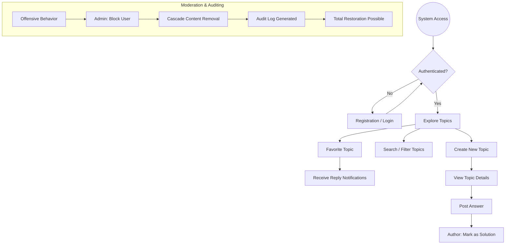

# 01 - Introduction and Ecosystem Overview

**ForumHub** is not just a forum API; it is a complete Full Stack ecosystem designed to demonstrate the viability of a modern **Modular Monolith**. This document details the project's foundation, its strategic goals, and the intended end-user experience.

## 🎯 Project Mission
To provide a high-performance environment for technical knowledge exchange, where **proactive security** and **data integrity** are guaranteed by automated layers of auditing and moderation.

## 🗺️ User Journey (Value Flow)

Below is the macro flow a user follows from access to advanced interaction:

## 🛠️ Detailed Tech Stack

### Backend (The Brain)
- **Java 17 & Spring Boot 3.4:** Application core.
- **Spring Security + JWT:** Stateless authentication with real-time blocking validation.
- **Spring Data JPA & Hibernate:** Robust object-relational mapping.
- **Flyway:** Controlled evolution of the SQL schema.
- **Redis:** Second-level cache and Rate Limiting.

### Frontend (The Interface)
- **Vue.js 3 (Composition API):** Modern reactive logic.
- **Vuetify 3:** UI framework based on Material Design with **Deep Dark** theme.
- **Pinia:** Decentralized global state management.
- **Vite:** Ultra-fast build tool.

### Quality and Infrastructure
- **Docker & Docker Compose:** Container orchestration for MySQL, Redis, and Applications.
- **Cypress:** End-to-End tests simulating real user behavior.
- **JUnit 5 & Mockito:** Unit and integration tests with high coverage.

## 🌟 Crucial Implementation Details
- **Case Sensitivity:** Topic title search is case-insensitive in MySQL to enhance UX.
- **Timezone:** The system uses `UTC` internally for all timestamps, converting to the user's local time only during frontend rendering.
- **Resilience:** If the Redis service fails, the application enters *Pass-Through* mode, fetching data directly from MySQL to avoid downtime.
- **UUID v4:** IDs for topics, users, and answers are non-sequential, preventing competitors or attackers from estimating the forum's data volume.
