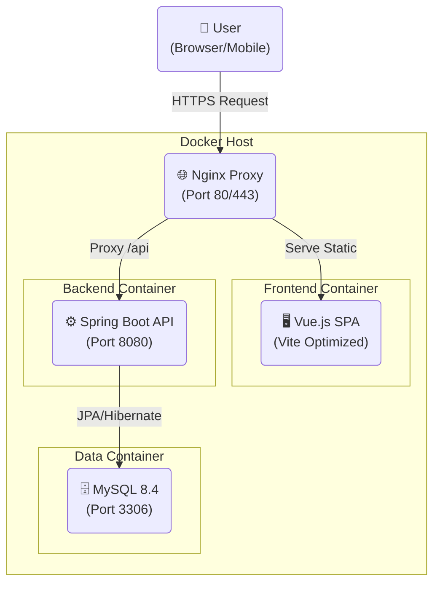
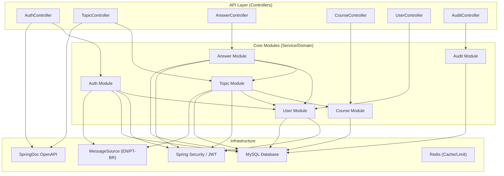
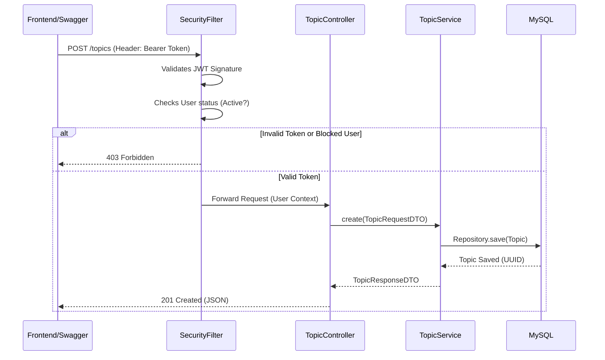

# 02 - Software Architecture

This document details the architectural decisions, system design, and patterns adopted in **FórumHub**. The application follows **Clean Code**, **SOLID** principles and uses a **Modular Monolith** architecture to ensure organization and scalability without the premature complexity of microservices.

## 🏗️ Overview (C4 Model)

FórumHub clearly separates the Frontend (SPA) from the Backend (REST API), communicating exclusively via JSON.

### Container Diagram (C4 Level 2)

### Backend Internal Architecture (Modular Monolith)

The backend is divided into independent domain modules, reducing coupling and facilitating maintenance.

---

## 🏛️ Architectural Decisions (ADRs)

### 1. Frontend-Backend Separation (Decoupled Architecture)
- **Decision:** Separate the UI (Vue.js) from the Business Logic (Spring Boot).
- **Status:** Implemented.
- **Motivation:** Allows independent team development and facilitates horizontal scaling of the backend.

### 2. Stateless Authentication (JWT)
- **Decision:** Use JSON Web Tokens (JWT) for authentication.
- **Status:** Implemented and Documented with Swagger.
- **Detail:** Implemented **Bearer Auth** support in Swagger UI, allowing protected tests directly in the browser.

### 3. Database Migration (Flyway)
- **Decision:** Use Flyway to manage the database schema in a versioned manner.
- **Status:** Implemented (V1 to V5).

### 4. Use of Deterministic UUIDs
- **Decision:** Use `BINARY(16)` for all primary IDs.
- **Motivation:** Superior performance compared to `VARCHAR(36)` and prevention against ID enumeration attacks.

### 5. Internationalization (i18n)
- **Decision:** Backend responds error messages based on the `Accept-Language` header.
- **Status:** Implemented (Files `messages_en.properties` and `messages_pt_BR.properties`).
- **Motivation:** Global support for the API, decoupling error messages from the source code.

---

## 🔌 Critical Data Flows

### 1. Secure Topic Creation
This flow demonstrates security validation and persistence.

---

## ⚡ Security and Performance (Infrastructure)

### 1. Distributed Caching Layer (Redis)
- **Decision:** Use Redis as a Second Level Cache (L2 Cache).
- **Motivation:** Reduce latency and MySQL database resource consumption for frequent read operations (listings).
- **Implementation:** Cache applied to course and topic listings, with automatic invalidation (`@CacheEvict`) on write operations (POST/PUT/DELETE).

### 2. Traffic Control (Rate Limiting)
- **Decision:** Limit requests per IP using Redis.
- **Configuration:** Default limit of 100 requests per minute.
- **Motivation:** Prevent brute force attacks on login and mitigate DoS (Denial of Service) attempts.

### 3. Serialization Resilience (RestPage)
- **Decision:** Create the `RestPage<T>` wrapper for paginated objects.
- **Motivation:** Solve Jackson's limitation when deserializing Spring Data's `PageImpl` objects from Redis cache, eliminating the need for missing default constructors in the original class.

---

## 📦 Project Patterns (Design Patterns)

### Backend
- **Controller-Service-Repository:** Classic well-defined layers.
- **DTO (Data Transfer Object):** 
  - Exclusive exposure of immutable objects (`Java Records`).
  - **100% English** Naming and Documentation (e.g., `TopicRequestDTO`, `RegisterRequestDTO`).
  - Rich Swagger annotations (`@Schema`).
- **Global Exception Handling:** Centralization of errors with `GlobalExceptionHandler`, returning standardized and translated responses.

### Frontend
- **Manual Chunking (Vite):** Build optimization separating `vendor-vue` and `vendor-vuetify` for faster loading.
- **Service Layer:** Complete abstraction of Axios in `src/services/api.ts`.
