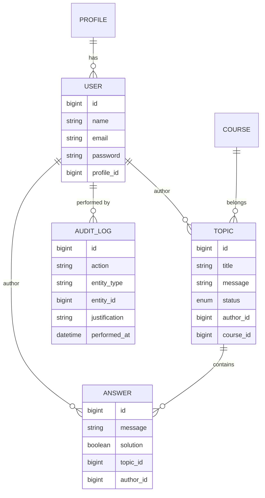
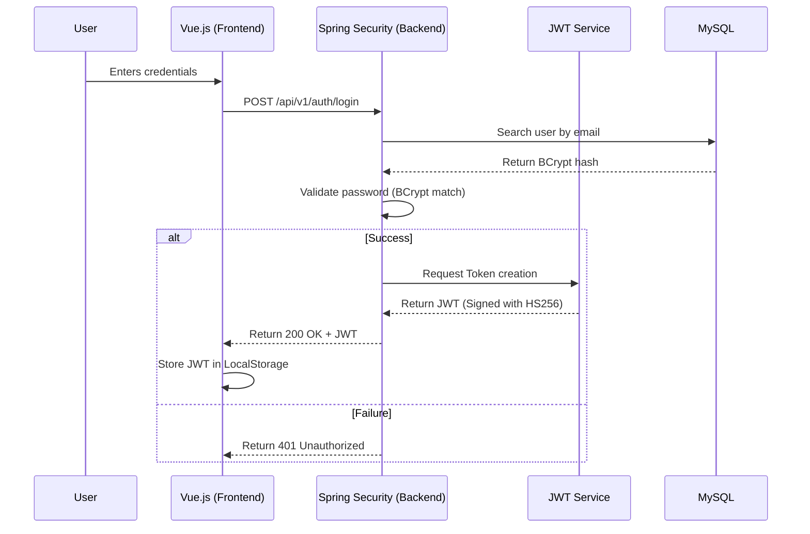

# Deep Architecture - FórumHub

## Design Patterns and Design Decisions

### 1. Layered Architecture
The backend follows the classic layered pattern but with modern refinements:
- **DTOs (Data Transfer Objects):** No JPA entities are directly exposed in the API. This prevents database logic leakage to the client and allows independent evolution of both sides.
- **Mappers (MapStruct):** We use MapStruct for automatic and performant conversions between Entities and DTOs, reducing boilerplate code.
- **Global Exception Handling:** A `@ControllerAdvice` centralizes error handling, ensuring the client always receives standardized responses even in case of unexpected failures.

### 2. Security Model (RBAC)
Security is based on functions (Role-Based Access Control):
- **JWT Token:** Contains custom claims (such as user email and permissions).
- **Stateless:** The server does not store sessions, which facilitates horizontal scalability.
- **Security Filter:** A filter intercepts each request, validates the token, and populates the Spring `SecurityContext`.

## Data Model (ER)
The database has been normalized to ensure data integrity and performance in complex queries.

## Detailed Authentication Flow
The login and authorization process follows rigorous security standards:

## Testing Strategy
- **Unit Tests:** Focus on the business logic of Services using Mockito to isolate dependencies.
- **Integration Tests:** Use the `test` profile with H2 database to validate the full cycle Request -> Controller -> Service -> Repository.
- **Frontend:** Vitest ensures that Pinia states and mutations occur as expected.