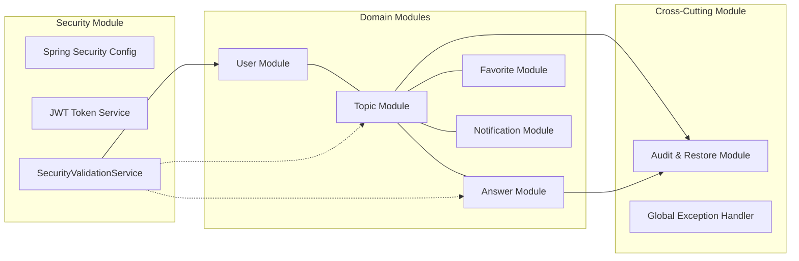
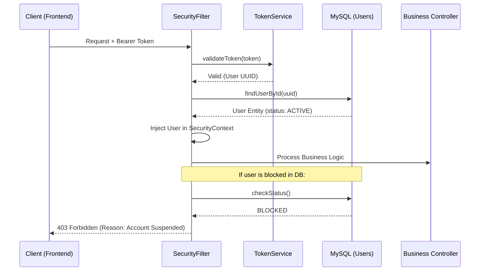
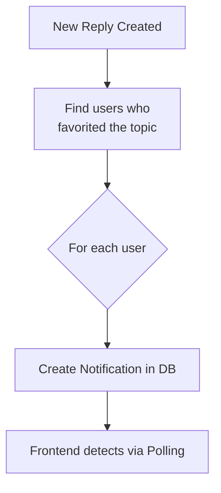

# 02 - Software Architecture: The Internal Mechanism

ForumHub uses a **Modular Monolith** architecture. This means that while the code is a single deployment unit, domains are logically separated to avoid coupling.

## 🧱 Modular Decomposition

---

## 🔐 Authentication and Blocking Validation Flow

Unlike common JWT systems, ForumHub validates the user's state in the database **on every write request**, even if the token is valid.

---

## 🚀 Processing Layers (Layered Architecture)

Each module strictly follows these layers:

1.  **Web Layer (Controller):** Defines endpoints, receives DTOs, and validates basic syntax via `@Valid`.
2.  **Business Layer (Service):** Where the "heart" of the system resides. Orchestrates transactions (`@Transactional`) and validates business rules (e.g., "Cannot reply to a closed topic").
3.  **Persistence Layer (Repository):** Spring Data JPA abstraction over SQL.
4.  **Security Validation Layer:** Interceptor filter that ensures the action performer is the resource owner or a moderator.

---

## 📡 Asynchronous Notification Flow (Internal Implementation)

When an event occurs (e.g., new reply), the system triggers notifications for all interested parties (whoever favorited the topic).

## 🛠️ Infrastructure Fundamentals
- **CORS Config:** The backend allows requests only from the origin defined in `.env` (e.g., `localhost:3000`), blocking malicious sites from accessing the API.
- **BCrypt:** Passwords are saved with `cost factor 10`. Even if the database is leaked, passwords will take decades to crack by brute force.
- **Connection Pooling:** We use **HikariCP** configured to manage the MySQL connection pool, ensuring the application handles traffic spikes without crashing the database.
