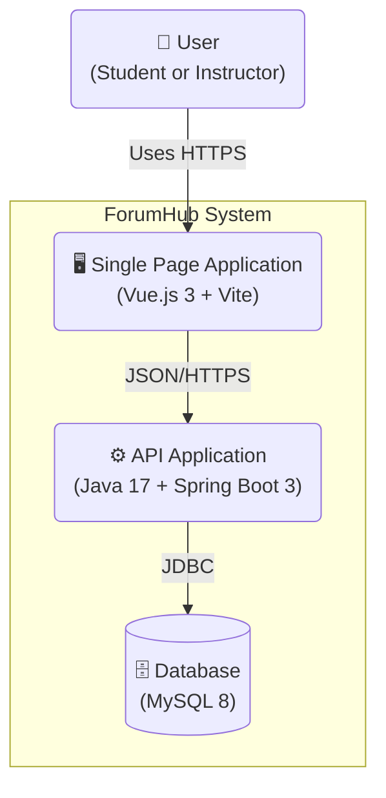
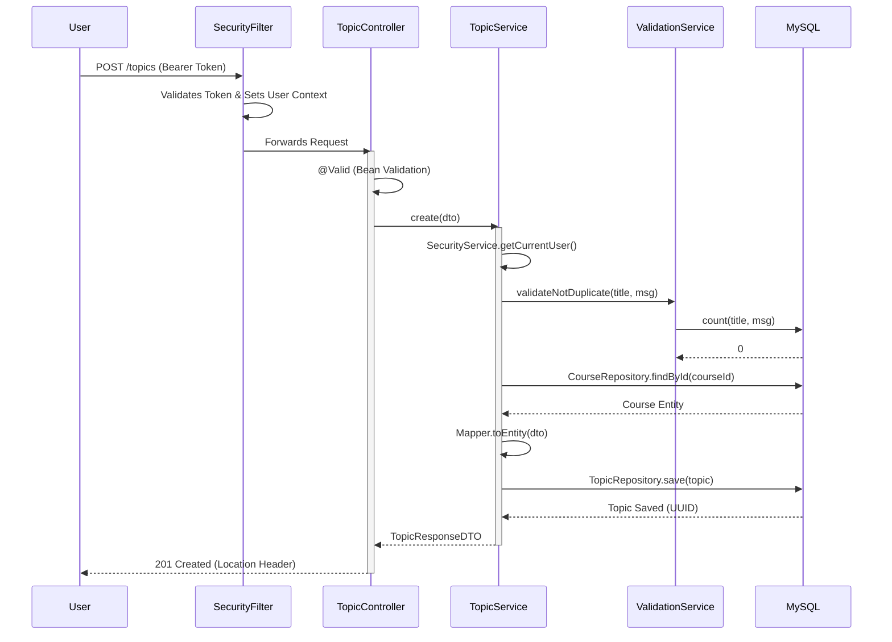

# 02 - Software Architecture

This document details the architectural decisions, system design, and patterns adopted in **ForumHub**.

## 🏗️ Overview (C4 Model)

ForumHub follows a **Modular Monolith** architecture, clearly separating the Frontend (SPA) from the Backend (REST API) while maintaining deployment simplicity.

### Container Diagram

---

## 🏛️ Architectural Decision Records (ADRs)

### 1. Decoupled Architecture (Frontend-Backend Separation)
- **Decision:** Separate UI (Vue.js) from Business Logic (Spring Boot).
- **Motivation:** Allows independent team development, facilitates horizontal backend scaling, and enables future clients (e.g., Mobile App) to consume the same API.

### 2. Stateless Authentication (JWT)
- **Decision:** Use JSON Web Tokens (JWT) for authentication.
- **Motivation:** Eliminates server-side session synchronization (stateless), ideal for containerized and scalable environments.

### 3. Versioned Database Migration (Flyway)
- **Decision:** Use Flyway to manage database schema.
- **Motivation:** Ensures database state is reproducible in any environment (Dev, Test, Prod) and avoids manual SQL conflicts.

### 4. Deterministic UUIDs (BINARY 16)
- **Decision:** Use `BINARY(16)` for all primary IDs.
- **Strategy:** Unlike `VARCHAR(36)`, `BINARY(16)` uses less disk space and improves index performance. Using UUIDs prevents "ID Enumeration Attacks", where attackers could predict sequential IDs to mine data.

---

## 🛡️ Proactive Security Patterns

### Defense in Depth
The system does not rely solely on JWT signature. For every protected request, the `SecurityValidationService` performs a quick database lookup to verify if the user's account was suspended or banned **after** the token was issued, ensuring punished users lose access in real-time.

### Moderation Hierarchy
Permission logic is hardcoded to protect the system from abuse:
- Admins can manage everyone.
- Moderators can manage regular users, but the system blocks actions against Administrators or other Moderators of the same level.

---

## 🔌 Real Data Flow

The diagram below illustrates the exact flow of a topic creation request, as implemented in `TopicService`:

---

## 📦 Design Patterns

### Backend
- **Controller-Service-Repository:** Classic separation of concerns.
  - *Controller:* Handles HTTP and input validation.
  - *Service:* Contains pure business rules.
  - *Repository:* Data access abstraction (Spring Data JPA).
- **DTO (Data Transfer Object):** We never expose JPA Entities directly. We use DTOs (`TopicRequestDTO`, `TopicResponseDTO`) to decouple domain models from the API contract.
- **Mapper Pattern:** Using **MapStruct** for performant Entity <-> DTO conversion without boilerplate.

### Frontend
- **Composition API:** Used instead of Options API for better logic reuse (Composables) and TypeScript type inference.
- **Store Pattern (Pinia):** Centralized state management for global data (User Session, Theme).
- **Service Layer:** The frontend has a service layer (`src/services/api.ts`) abstracting HTTP calls (Axios), avoiding direct coupling in visual components.
