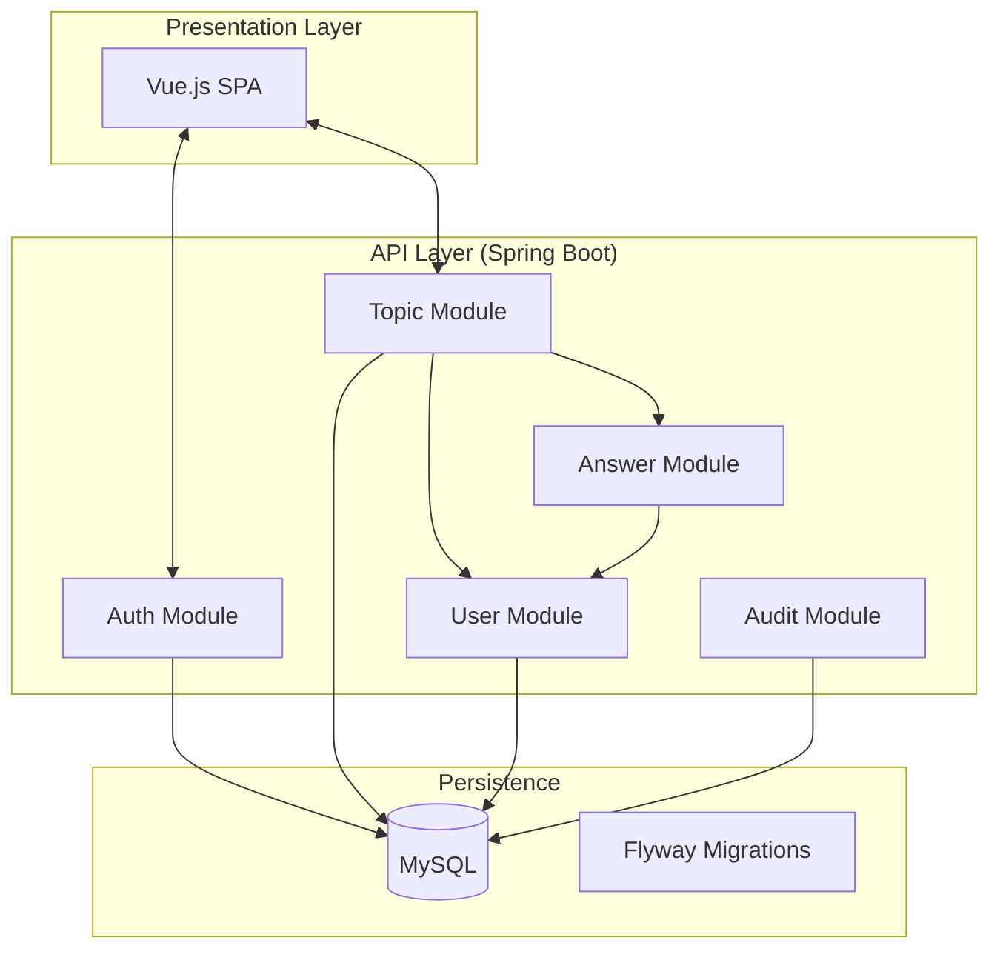

# 02 - System Architecture

## 🏗️ Modular Monolith
The system utilizes a **Modular Monolith** architecture. This means that although everything is delivered in a single artifact, the code is organized into independent modules with well-defined responsibilities.

### Block Diagram

## 📐 Design Principles
- **SOLID:** Each class has a single responsibility. For example, we created `SecurityValidationService` specifically to handle authorization rules, removing this burden from the controllers.
- **DRY (Don't Repeat Yourself):** Common validations were moved to utility services.
- **Clean Code:** Method names reveal their intention (e.g., `markAsSolution` instead of `updateStatus`).
