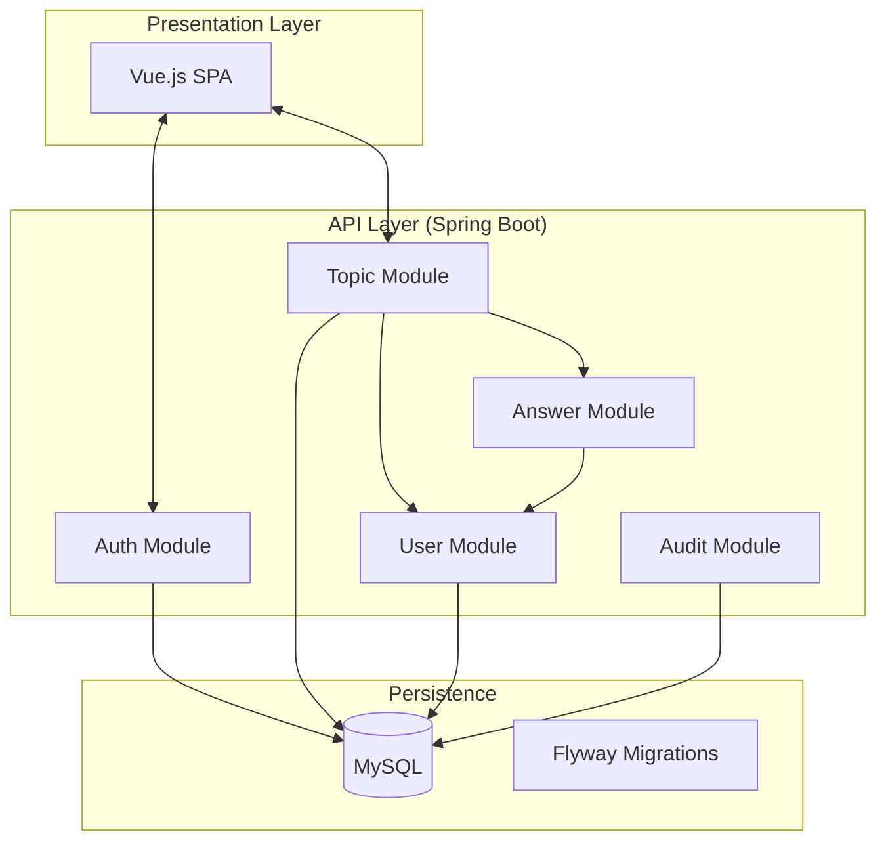

# 02 - System Architecture

## 🏗️ Modular Monolith
The system utilizes a **Modular Monolith** architecture. This ensures isolation between domain business rules while maintaining deployment simplicity.

### Block Diagram

## 🛡️ Architectural Decisions (ADRs)
Key project decisions are documented in [ADRs](../decisions/):
1. **ADR 001:** Modular Monolith choice.
2. **ADR 002:** Stateless Authentication with JWT.
3. **ADR 003:** Mandatory Auditing.
4. **ADR 004:** **Immutable UUIDs:** Replacing sequential IDs with random UUIDs to prevent IDOR and ensure data restoration integrity.

## 🆔 Entity Identification
All entities use `java.util.UUID` as their primary key. In the database, they are stored as `BINARY(16)` for maximum performance. Foreign keys follow this pattern, ensuring that audit log references remain valid even after deletion and restoration.

## 📐 Design Principles
- **SOLID:** Strict application. `SecurityValidationService` isolates security complexity, and `Mappers` (MapStruct) isolate data conversion.
- **Repository Pattern:** Complete database abstraction via Spring Data JPA.
- **Service Layer:** All business logic resides exclusively in services, never in controllers.
- **Clean Code:** Self-explanatory method names in English, small functions, and highly testable code.