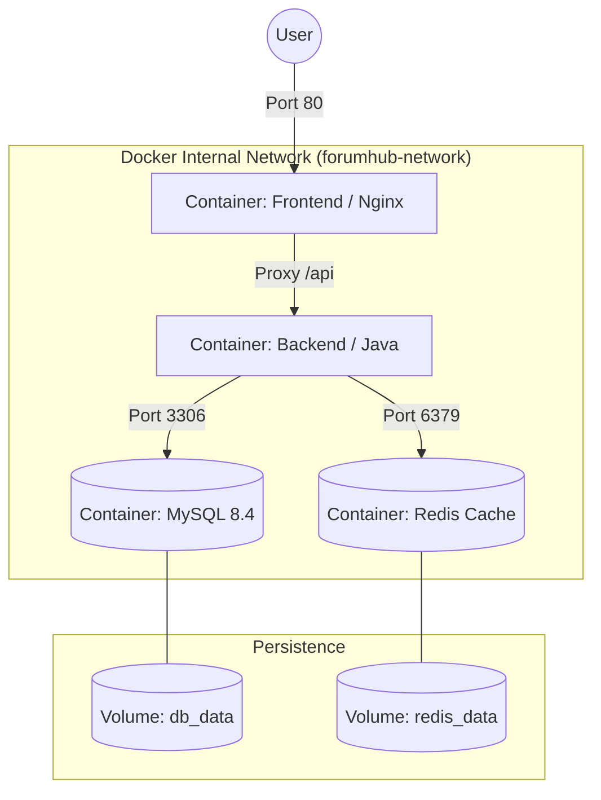
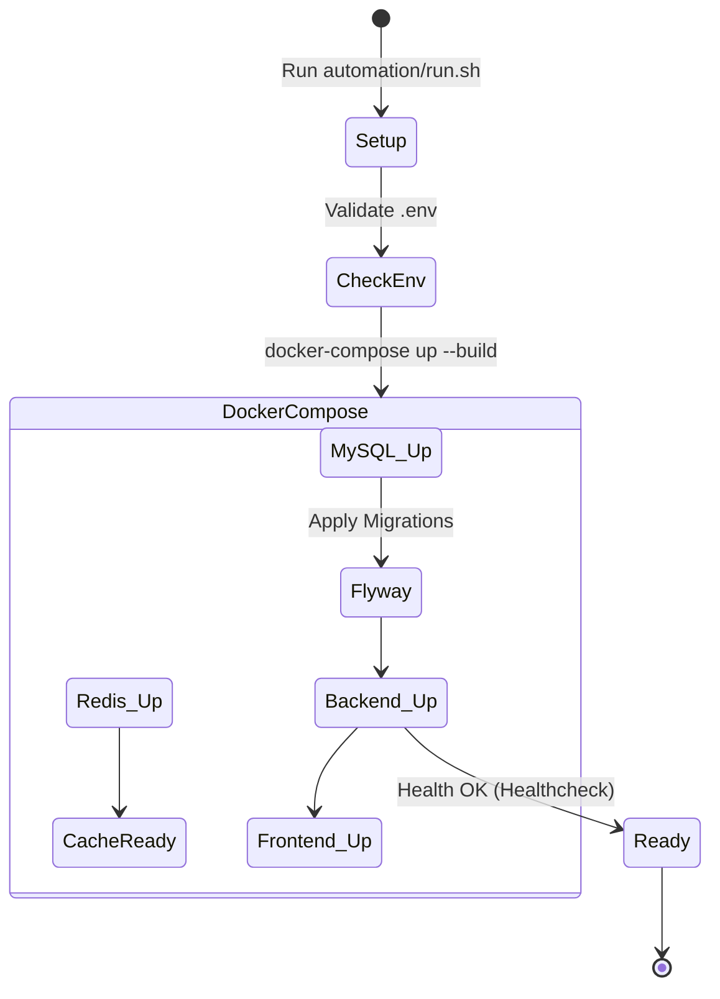

# 03 - Infrastructure: Docker and Orchestration

ForumHub operates under the concept of **Immutable Infrastructure** via containers. This document describes how components communicate within the Docker network and how volumes ensure persistence.

## 🐳 Docker Network Topology

All containers are connected to the `forumhub-network`. Isolation is total: MySQL and Redis are **not accessible outside the Docker network**, except if explicitly mapped.

---

## 🛠️ Deployment Flow (Container Lifecycle)

We use automated scripts to ensure the development environment is identical to production.

---

## ⚡ Cache and Resilience (Redis Depth)

### How is the Cache managed?
1.  **Cache Key:** Composed of method name + parameters (e.g., `topics::page0_size10`).
2.  **Invalidation:** Whenever a new topic is created or updated, the system calls `@CacheEvict(allEntries = true)`, ensuring the user never sees stale data for more than a few milliseconds.

### Rate Limit Strategy
Redis stores the access counter per IP with a TTL (Time To Live) of 60 seconds.
- If `IP_Count > 100` -> Returns HTTP 429.
- The TTL ensures that the block automatically expires after one minute of inactivity.

---

## 🔐 Sensitive Configurations (The .env file)

The project relies on environment variables. Below are the details for each:

| Variable | Function | Default Value |
| :--- | :--- | :--- |
| `MYSQL_ROOT_PASSWORD` | MySQL administrative password | `root` |
| `MYSQL_DATABASE` | Database name created on boot | `forumhub` |
| `API_SECURITY_TOKEN_SECRET` | Key to sign JWTs | (Change in Production!) |
| `SPRING_DATA_REDIS_HOST` | Redis hostname in Docker network | `redis` |

---

## 📝 Maintenance Notes
- **Logs:** Container logs can be accessed via `docker-compose logs -f backend`. They are configured with Spring's Logback to display colors in the terminal and precise timestamps.
- **Total Wipe:** To reset the environment completely (including the database), use `docker-compose down -v`, which removes persistent volumes.