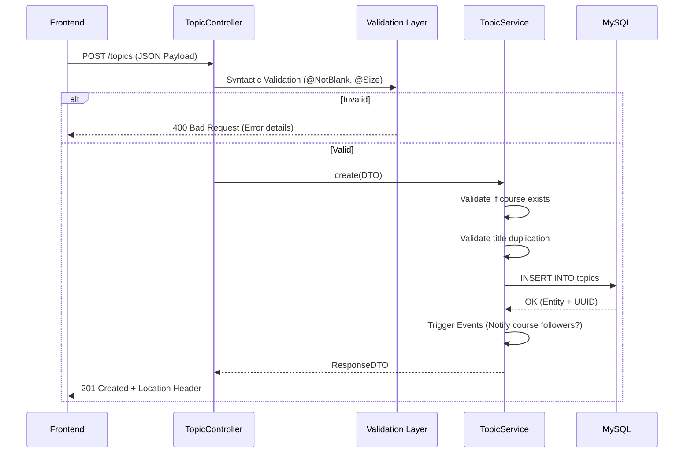
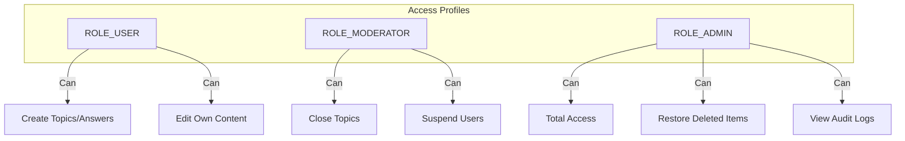

# 04 - REST API: Contracts and Data Flows

The ForumHub API is the central point of communication. It was designed to be **consistent**, **predictable**, and **documented**.

## 🔑 Resource Creation Flow (Topics)

Creating a topic involves multiple validations and automatic triggers.



---

## 📡 Smart Listing (Filters and Pagination)

The listing doesn't just return data; it applies dynamic filters and caching.

| Endpoint | Parameters | Description |
| :--- | :--- | :--- |
| `GET /api/v1/topics` | `page`, `size`, `sort`, `title`, `status`, `courseId` | Lists topics with stable pagination. |

### Golden Rule of Pagination:
Pages start at index **0**. If the frontend requests page 1 with 10 items, it will receive items 11 through 20.

---

## 🔐 Role-Based Access Control (RBAC)

We implement granular control over who can do what:



---

## 🛠️ Validation Details (Exact Fields)

For each creation request, the system validates:
- **Title:** Minimum 5, maximum 100 characters.
- **Message:** Minimum 10, maximum 5000 characters.
- **Course:** Must be an active course ID in the system.

### Validation Error Response Example (400):
```json
{
  "timestamp": "2026-01-07T18:30:00Z",
  "status": 400,
  "error": "Bad Request",
  "errors": {
    "title": "Title cannot be blank",
    "message": "Message must be at least 10 characters"
  }
}
```

---

## 📚 Swagger Documentation (OpenAPI)
Available at: `http://localhost:8080/swagger-ui.html`
- Documentation is automatically generated from code annotations.
- Each endpoint has a JSON input example.
- Models (Schemas) describe each field, whether it's mandatory, and its format (e.g., UUID).