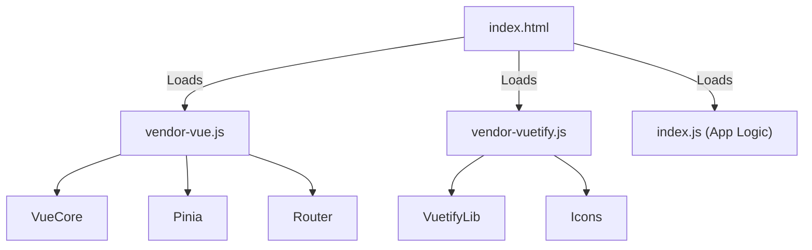

# 05 - Frontend (Vue.js 3)

ForumHub's frontend prioritizes clarity and efficiency, using the latest technologies from the Vue ecosystem.

## 🎨 User Experience (UX)
The interface uses the **Deep Dark** theme, optimizing the experience in low-light environments and following mobile-first standards.

### Design System
| Element | Specification |
| :--- | :--- |
| **Main Palette** | Pure Black (#000000) and Sky Blue (#38BDF8) |
| **Typography** | Inter (or modern Sans-Serif standard) |
| **Borders** | `border-radius: 4px` on all buttons and inputs |
| **Transitions** | 150ms ease-in-out for hover interactions |

### Responsive Behavior
- **Mobile (< 960px):**
  - Topics displayed in a single column (full-width).
  - Floating or simplified "New Topic" button in the navbar.
  - Sidebar hidden behind a hamburger menu.
- **Desktop (> 1280px):**
  - Topic grid in 3 columns.
  - Direct navigation links in the App Bar.
  - 1400px max-width to prevent visual dispersion.

---

## 🏗️ State Management (Pinia)
State is decentralized into stores:
- **TopicStore:** Preserves `status`, `courseId`, and `title` filters during pagination.
- **AuthStore:** Manages the JWT token and decodes roles for visual access control.
- **FavoriteStore:** Maintains a local `Set` of favorited IDs to ensure the star icon is instantly synced between the general list and the details page.
- **NotificationStore:** Polls every 30 seconds to update the alert counter. Clicking a notification marks it as read and navigates to the target topic.

---

## 🧩 Shared Components
- **FavoriteButton:** Reactive button that toggles favorite state with immediate visual feedback.
- **NotificationBell:** Alert centralizer in the Navbar with "Mark all as read" support.
- **AnimatedLogo:** Optimized SVG logo with subtle entry animations.

---

## ⚡ Performance & Build

### Bundle Optimization (Manual Chunking)
To ensure fast initial loading, `vite.config.ts` is configured to split code into strategic chunks:

This prevents heavy libraries (like Vuetify) from being re-downloaded every time application logic changes, better utilizing browser caching.

### Security
- **API Integration:** All HTTP calls pass through an interceptor in `src/services/api.ts` that automatically attaches the Bearer Token.
- **401 Handling:** Automatic redirection to login upon token expiration.