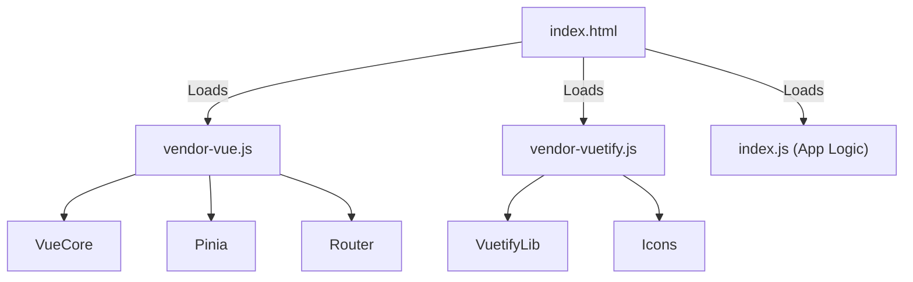

# 05 - Frontend (Vue.js 3)

ForumHub's frontend prioritizes clarity and efficiency, using the latest technologies from the Vue ecosystem.

## 🎨 User Experience (UX)
The interface is built entirely on **Vuetify 3**, ensuring all critical interactions occur through integrated components.

### Interface Patterns:
- **Dynamic Navigation:** Synchronization of filters and sorting directly with the URL.
- **Modal Workflows:** Edit and delete actions use `v-dialog`.
- **Non-Intrusive Feedback:** Notifications via `v-snackbar`.

---

## 🏗️ State Management (Pinia)
State is decentralized into stores:
- **TopicStore:** Preserves `status`, `courseId`, and `title` filters during pagination.
- **AuthStore:** Manages the JWT token and decodes roles for visual access control.
- **FavoriteStore:** Maintains a set of favorite topic IDs for the current user.
- **NotificationStore:** Manages real-time polling (every 30s) for unread counts and syncs UI state upon system events (like topic deletions).

---

## 🧩 Shared Components
- **FavoriteButton:** Star icon toggle with persistent state across lists and details.
- **NotificationBell:** Interactive bell in the navbar with unread count badge and notification history list.

---

## ⚡ Performance & Build

### Bundle Optimization (Manual Chunking)
To ensure fast initial loading, `vite.config.ts` is configured to split code into strategic chunks:

This prevents heavy libraries (like Vuetify) from being re-downloaded every time application logic changes, better utilizing browser caching.

### Security
- **API Integration:** All HTTP calls pass through an interceptor in `src/services/api.ts` that automatically attaches the Bearer Token.
- **401 Handling:** Automatic redirection to login upon token expiration.