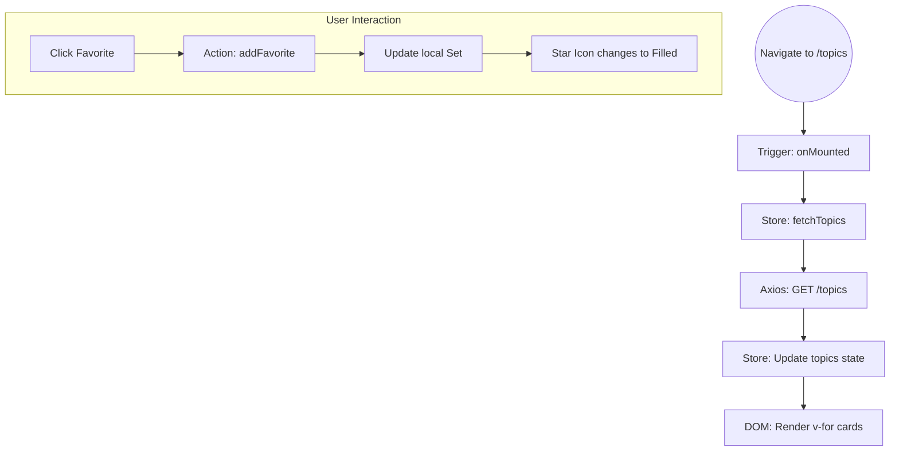
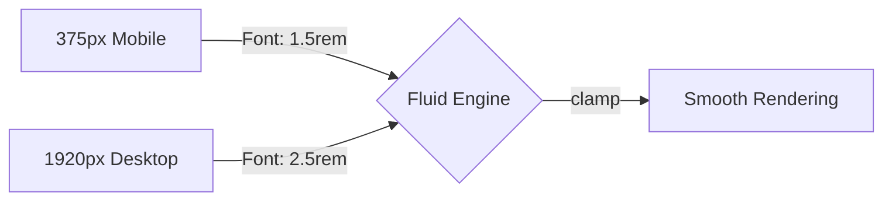

# 05 - Frontend: Reactive Architecture and UX

The ForumHub frontend is a **Single Page Application (SPA)** built with Vue.js 3, focused on response speed and immediate visual feedback.

## 🏗️ Component Rendering Flow

Each view in Vue.js follows a rigorous lifecycle to ensure data is ready before interaction.

---

## 💾 Centralized State Management (Pinia Hierarchy)

The application state is divided into independent "stores" that communicate when necessary.

| Store | Responsibility | Critical Data |
| :--- | :--- | :--- |
| **AuthStore** | Session and Permissions | `jwt_token`, `user_roles` |
| **TopicStore** | Listing and Pagination | `topics[]`, `totalPages` |
| **FavoriteStore** | Global Synchronization | `favoriteTopicIds (Set)` |
| **NotificationStore** | Polling and Alerts | `unreadCount` |

### Favorite Synchronization
We use a `Set` in `FavoriteStore` instead of an Array.
- **Why?** `Set.has(id)` has O(1) performance, allowing the favorite icon to be rendered instantly even when listing hundreds of topics.

---

## 🎨 Design System and Fluid Typography

The **Deep Dark** design uses pure colors to ensure the highest possible contrast on OLED screens.

### Viewport Scaling (Fluidity)
Not only is the layout responsive, but fonts and paddings are as well.

### Smart Buttons (Moderation Logic)
The visibility of buttons like "Ban Author" or "Restore Topic" is controlled by **Computed Properties** that check roles in the `AuthStore`. If the user lacks permission, the element is not even rendered in the DOM (`v-if`).

---

## 📡 Notification Polling (Technical Implementation)

The notification system does not use WebSockets to maintain simplicity and resilience.

1.  **Trigger:** The `TheNavbar` component starts a `setInterval` in `onMounted`.
2.  **Frequency:** Every 30 seconds.
3.  **Action:** Calls `notificationStore.fetchUnreadCount()`.
4.  **UX:** If the counter changes, the badge on the bell icon is updated with a "pulse" animation.

---

## 🛠️ Build Performance
`vite.config.ts` uses **Manual Chunking** to separate application code from libraries:
- `index.js`: ForumHub logic only (small, loads fast).
- `vendor-vuetify.js`: UI library (heavy, permanently cached in the browser).
- `vendor-vue.js`: Vue Core and Pinia (cached).