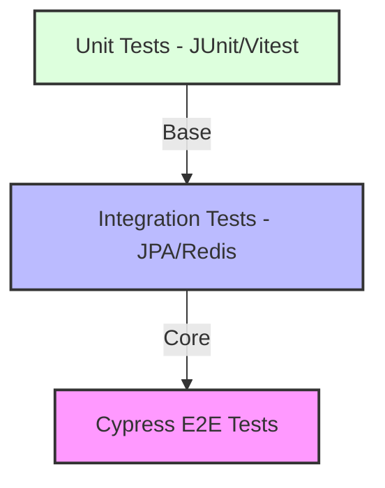
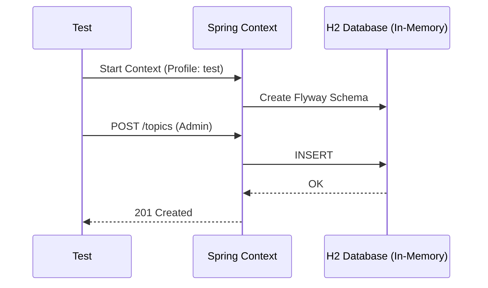
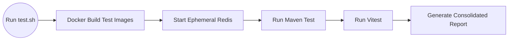

# 06 - Testing Strategy and Quality Assurance

ForumHub's quality is ensured by a battery of automated tests covering everything from the smallest business rule to the complete user flow.

## 📐 The Testing Pyramid

---

## 🧪 Backend Testing (Spring Boot)

### 1. Unit Tests
- **Focus:** Services and Business Rules.
- **Tool:** JUnit 5 + Mockito.
- **Example:** Validating that a blocked user cannot create a topic.

### 2. Integration Tests
- **Focus:** Persistence and Security.
- **Tool:** `@SpringBootTest` with H2 Database.
- **Flow:**

---

## 🖥️ Frontend Testing (Vue & Cypress)

### 1. Unit Tests (Vitest)
- Validation of Mappers, date formatters, and Store logic.

### 2. End-to-End Tests (Cypress)
Cypress simulates a real browser and interacts with the system as a human would.

**Resilience Flow (Hardening):**
Due to the asynchronous nature of Vue and Docker, we apply "smart wait" strategies:
1.  `cy.visit('/topics')`
2.  `cy.get('[data-cy="topic-card"]', { timeout: 60000 })` - Waits up to 60s for DB loading.
3.  `cy.contains('h1', 'Explore Topics')` - Ensures the layout is stable.

---

## 🚀 Automation Pipeline (`automation/test.sh`)

The test script automates environment setup to ensure isolation.

## 📝 Test Implementation Notes
- **`test` Profile:** The backend uses `application-test.yml`, which configures H2 as an in-memory database, making tests very fast.
- **Isolation:** Each integration test method in the backend uses `@Transactional` to ensure the database is automatically "cleaned" (Rollback) after each execution, preventing test cross-contamination.
- **Seeding:** `DataInitializer` is disabled in the test profile (`@Profile("!test")`) to ensure test data is manually controlled and predictable.
