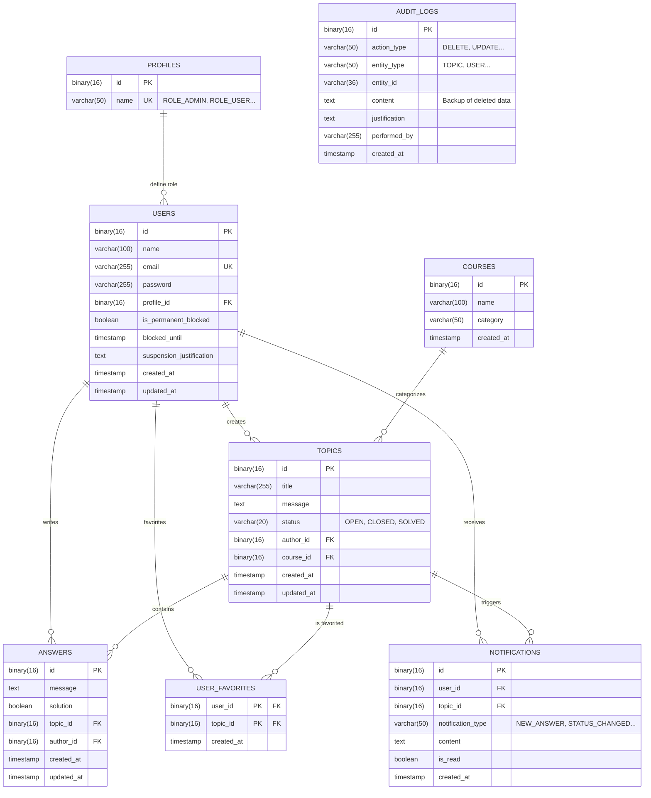

# 07 - Database

This document describes the exact database schema (MySQL 8) used by ForumHub, as defined in the Flyway migrations.

## 🗄️ Entity-Relationship Diagram (ERD)

The diagram below reflects the actual table structure, including data types and relationships.

## 📜 Structure and Migrations (Flyway)

The database is 100% managed via Flyway. The schema has evolved through the following versions:

### Version History
1. **V1:** Base structure (`users`, `profiles`, `courses`, `topics`, `answers`, `audit_logs`).
2. **V2:** Initial data load (Profiles and Admin User).
3. **V3:** User blocking system (`is_permanent_blocked`, `blocked_until`).
4. **V4:** Audit and suspension justification.
5. **V5:** Performance indexes (`idx_topics_author`, `idx_answers_topic`, etc).
6. **V6:** Favorites and Notifications system.

## 🔍 Types and IDs
- **UUIDs:** All primary IDs are `BINARY(16)` (UUID v4) for security and distribution, not sequential integers.
- **Audit:** The `audit_logs` table stores snapshots of deleted entities for compliance and recovery.