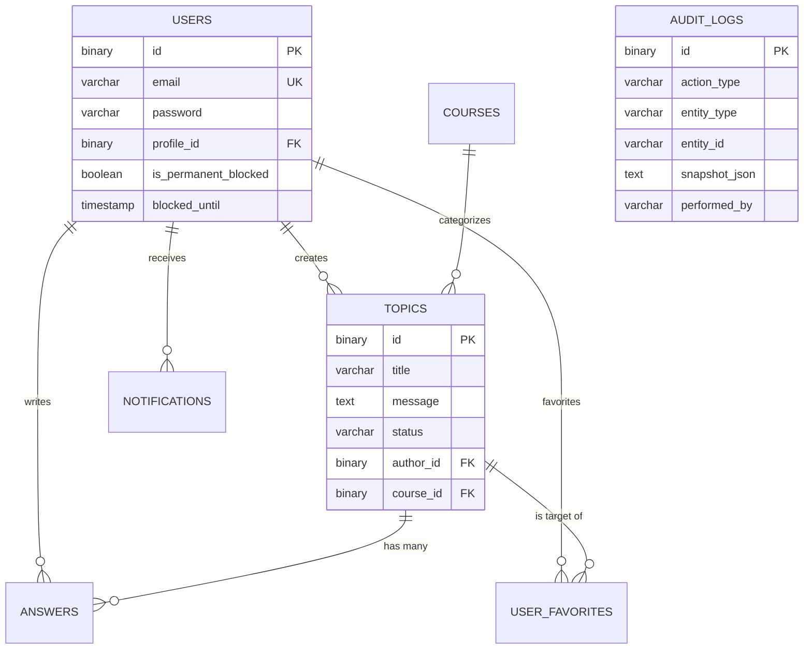

# 07 - Database: Mapping and Integrity

ForumHub uses **MySQL 8.4** with a schema designed for scalability and security. This document details the table structure, indexes, and migration management.

## 🗄️ Entity-Relationship Diagram (ERD)

Below is the visualization of the core entity connections:

---

## 🏗️ Schema Evolution (Flyway Path)

The database is never modified manually. Every change is a new `.sql` file in the history:

---

## ⚡ Performance Strategy (Indexing)

To ensure the API responds in under 100ms, we created specific indexes for the most common queries:

| Table | Indexed Column | Motivation |
| :--- | :--- | :--- |
| `topics` | `created_at` | Default home page sorting. |
| `topics` | `status`, `course_id` | Combined sidebar filters. |
| `notifications` | `user_id`, `is_read` | Polling query executed every 30s by all users. |
| `user_favorites` | `user_id` | Loading the "My Favorites" list. |

---

## 🔐 Data Security

### 1. Binary IDs (UUID)
We use `BINARY(16)` to store UUIDs.
- **Performance:** While in Java we see strings like `550e8400...`, in MySQL they occupy only 16 bytes—half the space of a CHAR(36) string—making indexes extremely compact and fast.

### 2. Audit Snapshots
The `audit_logs` table features a long text column that stores the JSON representation of the deleted entity. This allows data to be reconstructed with 100% fidelity even after physical deletion from the database.

---

## 📝 Integrity Rules (Constraints)
- **Cascade:** We do not use `ON DELETE CASCADE` to delete topics when a user is removed. Instead, we preserve the content and mark the author as "Deleted User" to maintain community history.
- **Unique:** A topic title is unique within a course over a 24-hour period (business logic validated in the Backend).