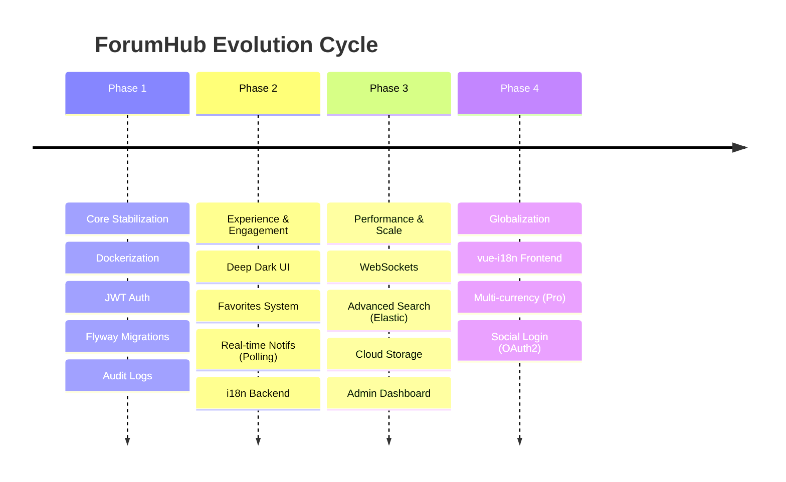

# 08 - Evolution Plan and Roadmap

This document defines the long-term vision for **ForumHub**, organizing improvements into logical phases of technological maturity.

## 🗺️ Visual Roadmap

---

## 📈 Detailed Technical Improvements

### 1. Transition to WebSockets (Notifications)
- **Current:** Polling every 30s.
- **Improvement:** Implement **Spring WebSocket + STOMP**.
- **Benefit:** Drastic reduction in useless HTTP calls and instant alert delivery (< 1s).

### 2. Full-Text Search (Elasticsearch)
- **Current:** Search via SQL `LIKE %...%`.
- **Improvement:** Integrate the `Topic` entity with an **Elasticsearch** cluster.
- **Benefit:** Support for fuzzy terms, "did you mean?" functionality, and high performance over millions of records.

### 3. Asset Management (Cloud Storage)
- **Current:** No image support.
- **Improvement:** Integration with **AWS S3** or **MinIO** for storing evidence in topics and profile pictures.

---

## 🛡️ Future Security
- **Dynamic Rate Limit:** Adjust limits based on Role (e.g., Admins have higher limits).
- **2FA (Two-Factor Auth):** Implement TOTP via Google Authenticator for administrative accounts.