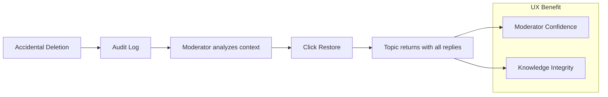

# 09 - Backend/Frontend Integration Analysis

ForumHub's competitive advantage lies in the perfect symbiosis between Java's robustness and Vue.js's fluidity. This document analyzes how backend choices drive the user experience.

## 🔗 Correlation Matrix: Backend -> UX

| Technical Choice | Visual/UX Impact | Why it matters? |
| :--- | :--- | :--- |
| **REST Page DTO** | Fluid Pagination | Users never wait for massive loads; the interface flows smoothly between pages. |
| **Binary UUIDs** | Friendly and Secure URLs | The URL ID (`/topics/550e8400...`) doesn't reveal system age and is immutable. |
| **JSON Audit Logs** | Admin Security (Undo) | Admins have the confidence to moderate, knowing any error can be reversed in one click. |
| **L2 Redis Cache** | Instant Speed | Popular topics load in sub-milliseconds, providing a native app feel. |

---

## 🗺️ Audit Value Flow (UX Perspective)

The restoration flow is the community's "Life Insurance."

---

## 💡 Design System Insights

### The Psychology of Deep Dark
The choice of a pure `#000000` background is not just aesthetic. On modern screens, it turns off pixels, reducing battery consumption on mobile devices and decreasing eye strain during long study sessions.

### Adaptive Menus (Smart UI)
Backend logic (`AuthStore`) informs the UI exactly which buttons to display.
- **Example:** If the backend reports that the topic author is blocked, the frontend automatically disables the reply field, preventing the user from wasting time writing for a topic that won't accept the submission.