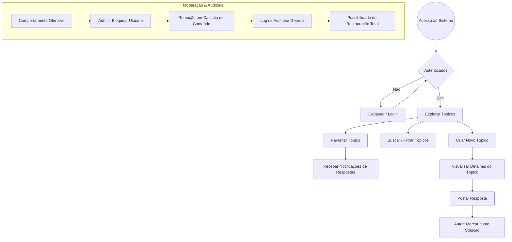

# 01 - Introdução e Visão Geral do Ecossistema

O **FórumHub** não é apenas uma API de fórum, é um ecossistema Full Stack completo, projetado para demonstrar a viabilidade de um **Monólito Modular** moderno. Este documento detalha a fundação do projeto, seus objetivos estratégicos e a experiência pretendida para o usuário final.

## 🎯 Missão do Projeto
Prover um ambiente de alta performance para troca de conhecimento técnico, onde a **segurança proativa** e a **integridade dos dados** são garantidas por camadas automatizadas de auditoria e moderação.

## 🗺️ Fluxo de Valor (User Journey)

Abaixo, o fluxo macro que um usuário percorre desde o acesso até a interação avançada:

## 🛠️ Stack Tecnológica Detalhada

### Backend (O Cérebro)
- **Java 17 & Spring Boot 3.4:** Core da aplicação.
- **Spring Security + JWT:** Autenticação stateless com validação de bloqueio em tempo real.
- **Spring Data JPA & Hibernate:** Mapeamento objeto-relacional robusto.
- **Flyway:** Evolução controlada do schema SQL.
- **Redis:** Cache de segundo nível e Rate Limiting.

### Frontend (A Interface)
- **Vue.js 3 (Composition API):** Lógica reativa moderna.
- **Vuetify 3:** Framework de UI baseado em Material Design com tema **Deep Dark**.
- **Pinia:** Gerenciamento de estado global descentralizado.
- **Vite:** Ferramenta de build ultra-rápida.

### Qualidade e Infraestrutura
- **Docker & Docker Compose:** Orquestração de containers para MySQL, Redis e Aplicações.
- **Cypress:** Testes End-to-End simulando o comportamento real do usuário.
- **JUnit 5 & Mockito:** Testes unitários e de integração com alta cobertura.

## 🌟 Detalhes Cruciais de Implementação
- **Case Sensitivity:** A busca por títulos de tópicos é insensível a maiúsculas/minúsculas no MySQL para facilitar a UX.
- **Timezone:** O sistema utiliza `UTC` internamente para todos os timestamps, convertendo para o local do usuário apenas na renderização do frontend.
- **Resiliência:** Se o serviço de Redis falhar, a aplicação entra em modo *Pass-Through*, buscando dados diretamente no MySQL para evitar downtime.
- **UUID v4:** IDs de tópicos, usuários e respostas não são sequenciais, impedindo que competidores ou atacantes estimem o volume de dados do fórum.
