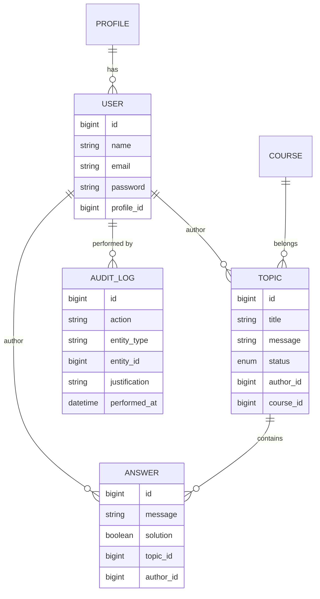
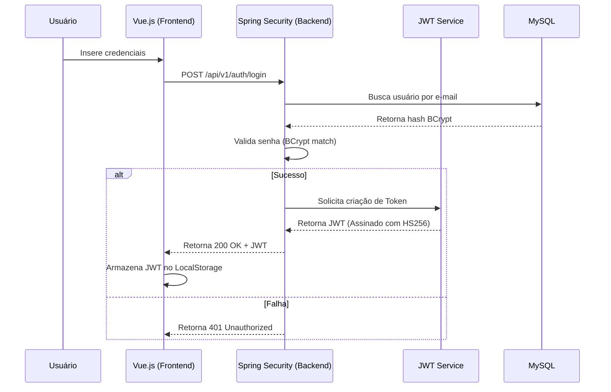

# Arquitetura Profunda - FórumHub

## Padrões de Projeto e Decisões de Design

### 1. Arquitetura em Camadas
O backend segue o padrão de camadas clássico, mas com refinamentos modernos:
- **DTOs (Data Transfer Objects):** Nenhuma entidade JPA é exposta diretamente na API. Isso previne o vazamento de lógicas de banco para o cliente e permite a evolução independente de ambos os lados.
- **Mappers (MapStruct):** Utilizamos o MapStruct para conversões automáticas e performáticas entre Entidades e DTOs, reduzindo código "boilerplate".
- **Global Exception Handling:** Um `@ControllerAdvice` centraliza o tratamento de erros, garantindo que o cliente sempre receba respostas padronizadas mesmo em caso de falhas inesperadas.

### 2. Modelo de Segurança (RBAC)
A segurança é baseada em funções (Role-Based Access Control):
- **Token JWT:** Contém `claims` personalizadas (como o e-mail do usuário e suas permissões).
- **Stateless:** O servidor não armazena sessões, o que permite a escalabilidade horizontal facilitada.
- **Security Filter:** Um filtro intercepta cada requisição, valida o token e popula o `SecurityContext` do Spring.

## Modelo de Dados (ER)
O banco de dados foi normalizado para garantir a integridade dos dados e performance em consultas complexas.

## Fluxo de Autenticação Detalhado
O processo de login e autorização segue rigorosos padrões de segurança:

## Estratégia de Testes
- **Unitários:** Focam na lógica de negócio dos Services usando Mockito para isolar dependências.
- **Integração:** Utilizam o perfil `test` com banco de dados H2 para validar o ciclo completo Request -> Controller -> Service -> Repository.
- **Frontend:** Vitest garante que os estados do Pinia e as mutações ocorram conforme o esperado.
