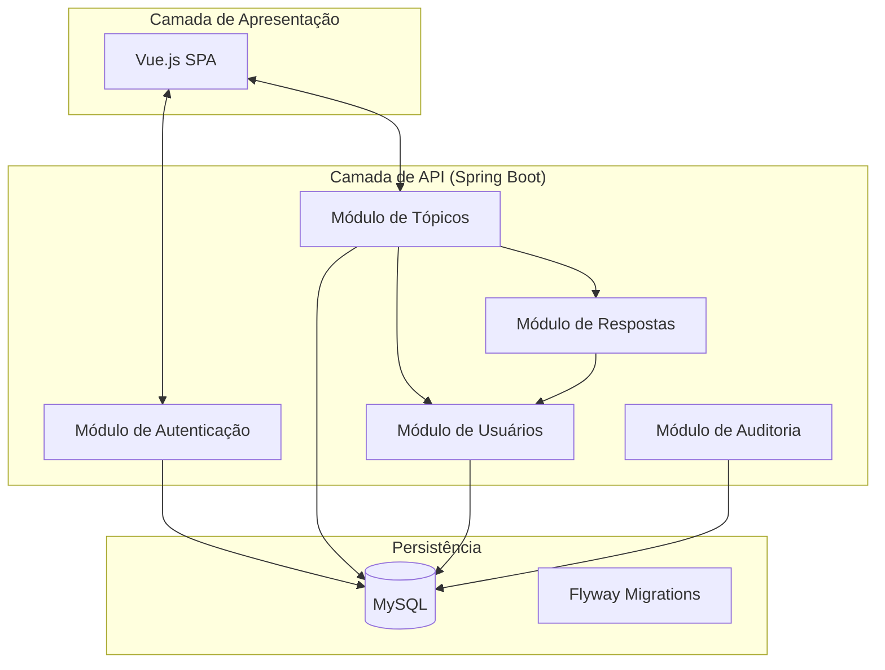

# 02 - Arquitetura do Sistema

## 🏗️ Monolito Modular
O sistema utiliza uma arquitetura de **Monolito Modular**. Isso significa que, embora tudo seja entregue em um único artefato, o código é organizado em módulos independentes com responsabilidades bem definidas.

### Diagrama de Blocos

## 🛡️ Decisões Arquiteturais (ADRs)
As principais decisões do projeto estão documentadas em [ADRs](../decisions/):
1. **ADR 001:** Escolha do Monolito Modular.
2. **ADR 002:** Autenticação Stateless com JWT.
3. **ADR 003:** Auditoria Mandatória.

## 📐 Princípios de Design
- **SOLID:** Cada classe tem uma única responsabilidade. Por exemplo, criamos o `SecurityValidationService` apenas para lidar com regras de autorização, removendo essa carga dos controladores.
- **DRY (Don't Repeat Yourself):** Validações comuns foram movidas para serviços utilitários.
- **Clean Code:** Nomes de métodos revelam sua intenção (ex: `markAsSolution` em vez de `updateStatus`).