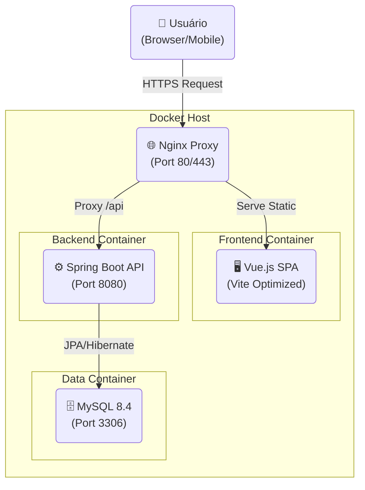
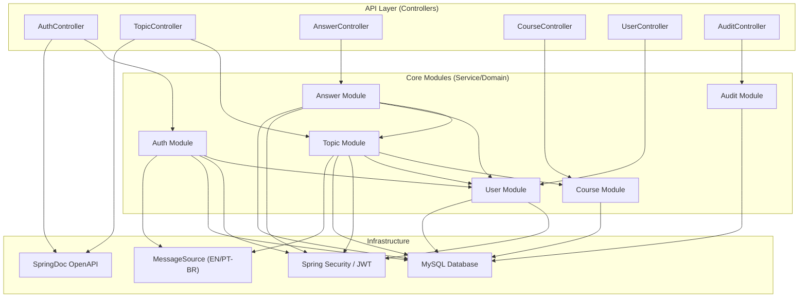
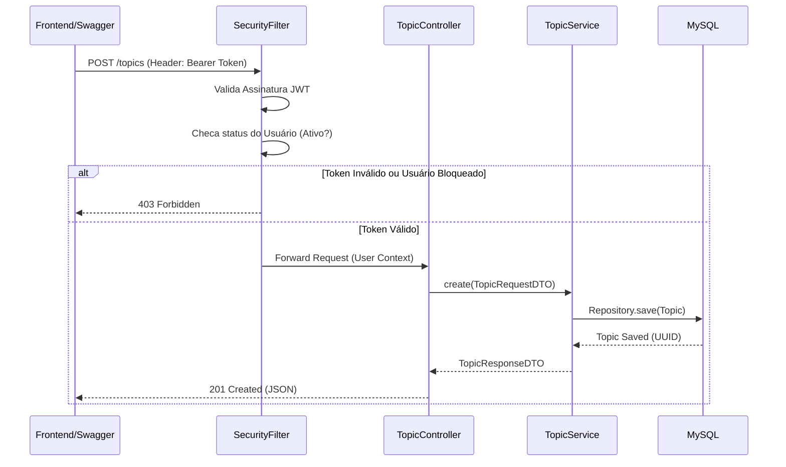

# 02 - Arquitetura de Software

Este documento detalha as decisões arquiteturais, o design do sistema e os padrões adotados no **FórumHub**. A aplicação segue os princípios de **Clean Code**, **SOLID** e utiliza uma arquitetura de **Monólito Modular** para garantir organização e escalabilidade sem a complexidade prematura de microsserviços.

## 🏗️ Visão Geral (C4 Model)

O FórumHub separa claramente o Frontend (SPA) do Backend (API REST), comunicando-se exclusivamente via JSON.

### Diagrama de Container (C4 Level 2)

### Arquitetura Interna do Backend (Modular Monolith)

O backend é dividido em módulos de domínio independentes, reduzindo o acoplamento e facilitando a manutenção.

---

## 🏛️ Decisões Arquiteturais (ADRs)

### 1. Separação Frontend-Backend (Decoupled Architecture)
- **Decisão:** Separar a UI (Vue.js) da Lógica de Negócio (Spring Boot).
- **Status:** Implementado.
- **Motivação:** Permite o desenvolvimento independente das equipes e facilita a escalabilidade horizontal do backend.

### 2. Autenticação Stateless (JWT)
- **Decisão:** Uso de JSON Web Tokens (JWT) para autenticação.
- **Status:** Implementado e Documentado com Swagger.
- **Detalhe:** Implementado suporte a **Bearer Auth** no Swagger UI, permitindo testes protegidos diretamente no navegador.

### 3. Migração de Banco de Dados (Flyway)
- **Decisão:** Uso do Flyway para gerenciar o esquema do banco de forma versionada.
- **Status:** Implementado (V1 a V5).

### 4. Uso de UUIDs Determinísticos
- **Decisão:** Utilizar `BINARY(16)` para todos os IDs primários.
- **Motivação:** Performance superior a `VARCHAR(36)` e prevenção contra ataques de enumeração de IDs.

### 5. Internacionalização (i18n)
- **Decisão:** Backend responde mensagens de erro baseadas no header `Accept-Language`.
- **Status:** Implementado (Arquivos `messages_en.properties` e `messages_pt_BR.properties`).
- **Motivação:** Suporte global para a API, desacoplando as mensagens de erro do código fonte.

---

## 🔌 Fluxos de Dados Críticos

### 1. Criação de Tópico Seguro
Este fluxo demonstra a validação de segurança e a persistência.

---

## 📦 Padrões de Projeto (Design Patterns)

### Backend
- **Controller-Service-Repository:** Camadas clássicas bem definidas.
- **DTO (Data Transfer Object):** 
  - Exposição exclusiva de objetos imutáveis (`Java Records`).
  - Nomenclatura e Documentação **100% em Inglês** (ex: `TopicRequestDTO`, `RegisterRequestDTO`).
  - Anotações Swagger (`@Schema`) ricas em detalhes.
- **Global Exception Handling:** Centralização de erros com `GlobalExceptionHandler`, retornando respostas padronizadas e traduzidas.

---

## ⚡ Segurança e Performance (Infraestrutura)

### 1. Camada de Cache Distribuído (Redis)
- **Decisão:** Utilização do Redis como cache de segundo nível (L2 Cache).
- **Motivação:** Reduzir a latência e o consumo de recursos do banco de dados MySQL em operações de leitura frequentes (listagens).
- **Implementação:** Cache aplicado nas listagens de cursos e tópicos, com invalidação automática (`@CacheEvict`) em operações de escrita (POST/PUT/DELETE).

### 2. Controle de Tráfego (Rate Limiting)
- **Decisão:** Limitar requisições por IP utilizando Redis.
- **Configuração:** Limite padrão de 100 requisições por minuto.
- **Motivação:** Prevenir ataques de força bruta no login e mitigar tentativas de DoS (Denial of Service).

### 3. Resiliência de Serialização (RestPage)
- **Decisão:** Criação do wrapper `RestPage<T>` para objetos paginados.
- **Motivação:** Resolver a limitação do Jackson ao deserializar objetos `PageImpl` do Spring Data vindos do cache Redis, eliminando a necessidade de construtores padrão ausentes na classe original.
