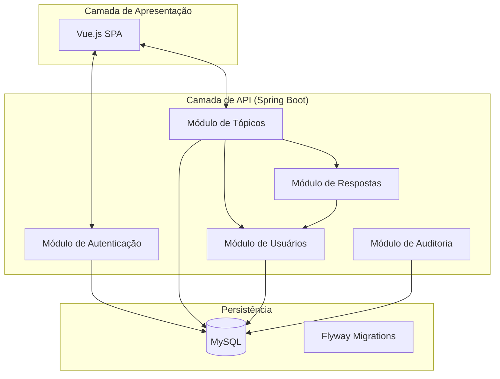

# 02 - Arquitetura do Sistema

## 🏗️ Monolito Modular
O sistema utiliza uma arquitetura de **Monolito Modular**. Isso garante isolamento entre as regras de negócio de cada domínio enquanto mantém a simplicidade de implantação.

### Diagrama de Blocos

## 🛡️ Decisões Arquiteturais (ADRs)
As principais decisões do projeto estão documentadas em [ADRs](../decisions/):
1. **ADR 001:** Escolha do Monolito Modular.
2. **ADR 002:** Autenticação Stateless com JWT.
3. **ADR 003:** Auditoria Mandatória.
4. **ADR 004:** **UUIDs Imutáveis:** Substituição de IDs sequenciais por UUIDs aleatórios para prevenir IDOR e garantir integridade em restaurações de dados.

## 🆔 Identificação de Entidades
Todas as entidades utilizam `java.util.UUID` como chave primária. No banco de dados, são armazenadas como `BINARY(16)` para máxima performance. Chaves estrangeiras também seguem esse padrão, garantindo que referências em logs de auditoria permaneçam válidas mesmo após exclusão e restauração.

## 📐 Princípios de Design
- **SOLID:** Aplicação rigorosa. O `SecurityValidationService` isola a complexidade de segurança, e os `Mappers` (MapStruct) isolam a conversão de dados.
- **Repository Pattern:** Abstração completa do banco via Spring Data JPA.
- **Service Layer:** Toda a lógica de negócio reside exclusivamente nos serviços, nunca nos controladores.
- **Clean Code:** Nomes autoexplicativos em inglês, funções pequenas e código altamente testável.
