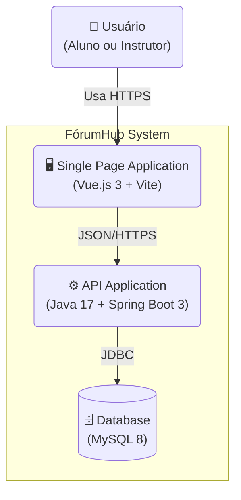
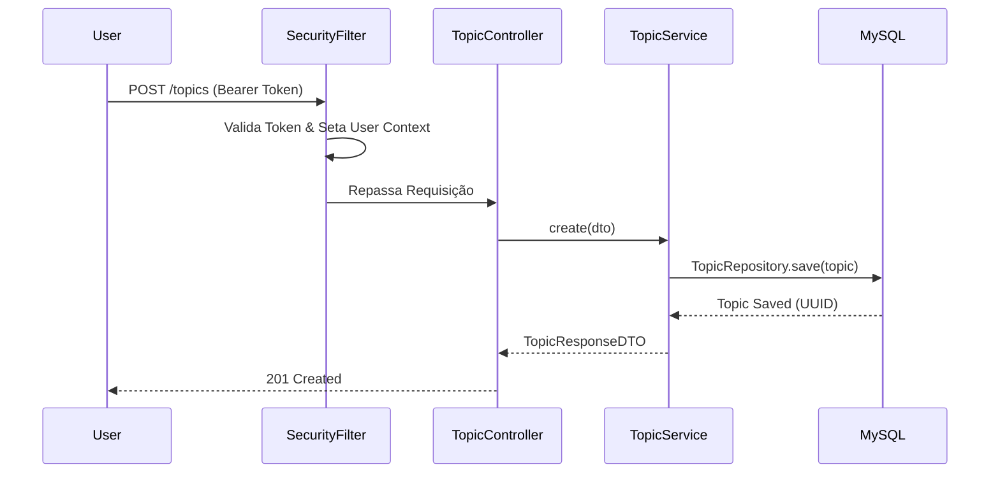
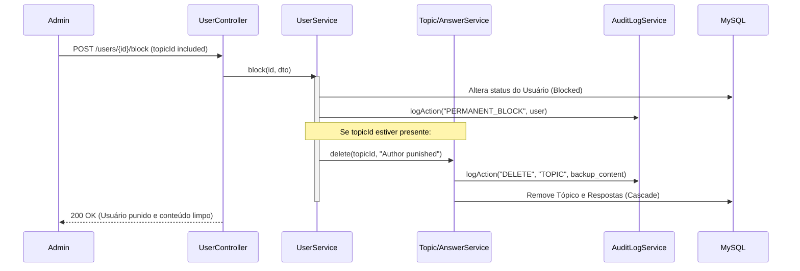

# 02 - Arquitetura de Software

Este documento detalha as decisões arquiteturais, o design do sistema e os padrões adotados no **FórumHub**.

## 🏗️ Visão Geral (C4 Model)

O FórumHub segue uma arquitetura de **Monólito Modular** (Modular Monolith), separando claramente o Frontend (SPA) do Backend (API REST), mas mantendo a simplicidade de implantação.

### Diagrama de Container

---

## 🏛️ Decisões Arquiteturais (ADRs)

### 1. Separação Frontend-Backend (Decoupled Architecture)
- **Decisão:** Separar a UI (Vue.js) da Lógica de Negócio (Spring Boot).
- **Motivação:** Permite o desenvolvimento independente das equipes, facilita a escalabilidade horizontal do backend e possibilita a criação futura de outros clientes (ex: App Mobile) consumindo a mesma API.

### 2. Autenticação Stateless (JWT)
- **Decisão:** Uso de JSON Web Tokens (JWT) para autenticação.
- **Motivação:** Elimina a necessidade de sincronização de sessão no servidor (stateless), o que é ideal para ambientes conteinerizados e escaláveis.

### 3. Migração de Banco de Dados Versionada (Flyway)
- **Decisão:** Uso do Flyway para gerenciar o esquema do banco.
- **Motivação:** Garante que o estado do banco de dados seja reprodutível em qualquer ambiente (Dev, Test, Prod) e evita conflitos de alterações manuais SQL.

### 4. Uso de UUIDs Determinísticos (BINARY 16)
- **Decisão:** Utilizar `BINARY(16)` para todos os IDs primários.
- **Estratégia:** Diferente do `VARCHAR(36)`, o `BINARY(16)` ocupa menos espaço em disco e melhora a performance dos índices. O uso de UUIDs previne o "ID Enumeration Attack", onde atacantes poderiam prever IDs sequenciais para minerar dados.

---

## 🛡️ Padrões de Segurança Proativa

### Defesa em Camadas (Defense in Depth)
O sistema não confia apenas na assinatura do JWT. Em cada requisição protegida, o `SecurityValidationService` realiza uma consulta rápida ao banco de dados para verificar se a conta do usuário foi suspensa ou banida **após** a emissão do token, garantindo que usuários punidos percam o acesso em tempo real.

### Hierarquia de Moderação
A lógica de permissões é codificada para proteger o sistema contra abusos:
- Admins podem gerenciar todos.
- Moderadores podem gerenciar usuários comuns, mas o sistema bloqueia tentativas de ação contra Administradores ou outros Moderadores de mesmo nível.

---

## 🔌 Fluxos de Dados Críticos

### 1. Criação de Tópico (Simplificado)

### 2. Moderação Contextual (Punição + Remoção)
Este fluxo ilustra a inteligência de limpeza automática ao punir um usuário:

---

## 📦 Padrões de Projeto (Design Patterns)

### Backend
- **Controller-Service-Repository:** Separação clássica de responsabilidades.
  - *Controller:* Trata HTTP e validação de entrada.
  - *Service:* Contém as regras de negócio puras.
  - *Repository:* Abstração de acesso a dados (Spring Data JPA).
- **DTO (Data Transfer Object):** Nunca expomos as Entidades JPA diretamente na API. Usamos DTOs (`TopicoRequestDTO`, `TopicoResponseDTO`) para desacoplar o modelo de domínio do contrato da API.
- **Mapper Pattern:** Uso do **MapStruct** para converter Entidades <-> DTOs de forma performática e sem boilerplate.

### Frontend
- **Composition API:** Utilizada em vez da Options API para melhor reutilização de lógica (Composables) e inferência de tipos com TypeScript.
- **Store Pattern (Pinia):** Gerenciamento de estado centralizado para dados globais (Sessão de Usuário, Tema).
- **Service Layer:** O frontend possui uma camada de serviço (`src/services/api.ts`) que abstrai as chamadas HTTP (Axios), evitando acoplamento direto nos componentes visuais.