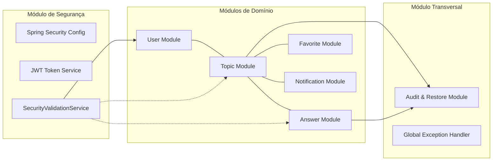
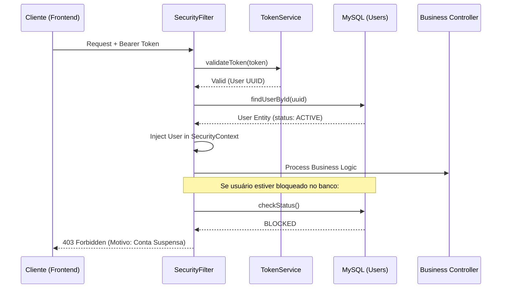
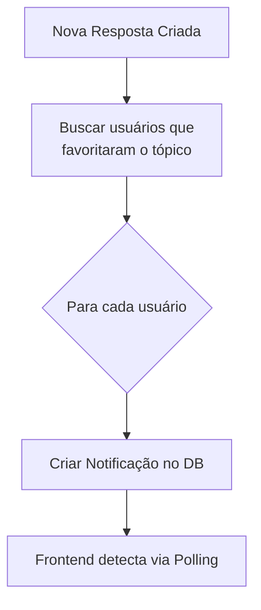

# 02 - Arquitetura de Software: O Mecanismo Interno

O FórumHub utiliza uma arquitetura de **Monólito Modular**. Isso significa que, embora o código seja um único deploy, os domínios são logicamente separados para evitar acoplamento.

## 🧱 Decomposição Modular

---

## 🔐 Fluxo de Autenticação e Validação de Bloqueio

Diferente de sistemas JWT comuns, o FórumHub valida o estado do usuário no banco de dados **a cada request de escrita**, mesmo que o token seja válido.

---

## 🚀 Camadas de Processamento (Layered Architecture)

Cada módulo segue estritamente estas camadas:

1.  **Web Layer (Controller):** Define os endpoints, recebe DTOs e valida a sintaxe básica via `@Valid`.
2.  **Business Layer (Service):** Onde reside o "coração" do sistema. Orquestra transações (`@Transactional`) e valida regras de negócio (ex: "Não pode responder tópico fechado").
3.  **Persistence Layer (Repository):** Abstração do Spring Data JPA sobre o SQL.
4.  **Security Validation Layer:** Filtro interceptador que garante que o autor da ação é o dono do recurso ou um moderador.

---

## 📡 Fluxo de Notificações Assíncronas (Implementação Interna)

Quando um evento ocorre (ex: nova resposta), o sistema dispara notificações para todos os interessados (quem favoritou o tópico).

## 🛠️ Fundamentos de Infraestrutura
- **CORS Config:** O backend permite requisições apenas da origem definida no `.env` (ex: `localhost:3000`), bloqueando sites maliciosos de acessarem a API.
- **BCrypt:** Senhas são salvas com `cost factor 10`. Mesmo se o banco for vazado, as senhas levarão décadas para serem decifradas por força bruta.
- **Connection Pooling:** Utilizamos **HikariCP** configurado para gerenciar o pool de conexões com o MySQL, garantindo que a aplicação aguente picos de tráfego sem derrubar o banco.
