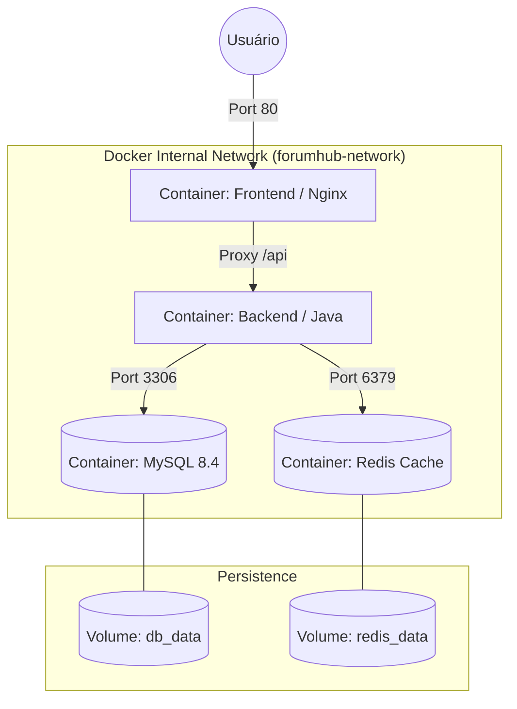
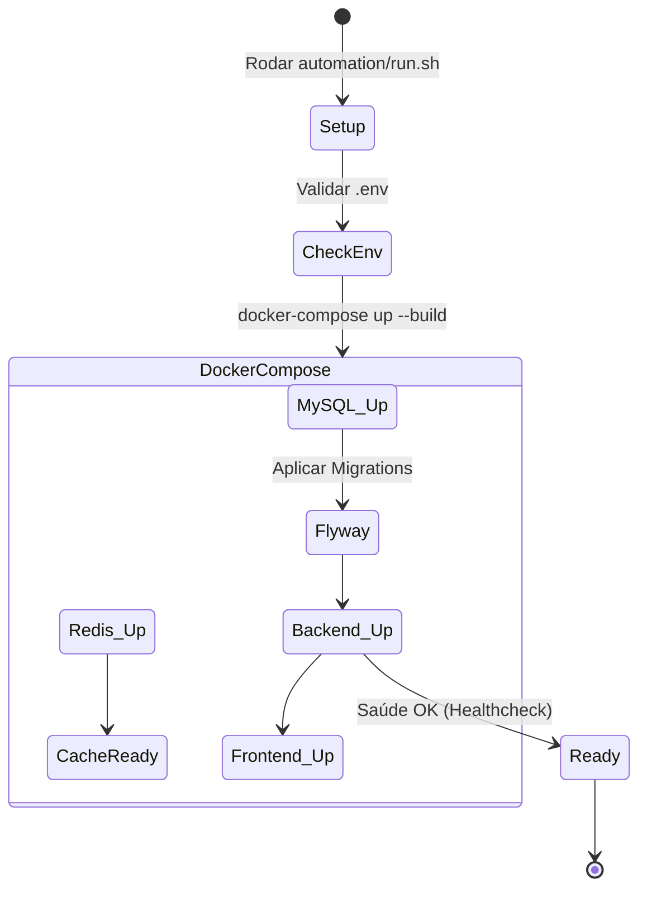

# 03 - Infraestrutura: Docker e Orquestração

O FórumHub opera sob o conceito de **Immutable Infrastructure** via containers. Este documento descreve como os componentes se comunicam na rede Docker e como os volumes garantem a persistência.

## 🐳 Topologia da Rede Docker

Todos os containers estão conectados na `forumhub-network`. O isolamento é total: o MySQL e o Redis **não são acessíveis fora da rede Docker**, exceto se explicitamente mapeados.

---

## 🛠️ Ciclo de Vida do Container (Deployment Flow)

Utilizamos scripts automatizados para garantir que o ambiente de desenvolvimento seja idêntico ao de produção.

---

## ⚡ Cache e Resiliência (Redis Depth)

### Como o Cache é gerenciado?
1.  **Chave de Cache:** Composta pelo nome do método + parâmetros (ex: `topics::page0_size10`).
2.  **Invalidação:** Sempre que um novo tópico é criado ou atualizado, o sistema chama `@CacheEvict(allEntries = true)`, garantindo que o usuário nunca veja dados obsoletos por mais de alguns milissegundos.

### Estratégia de Rate Limit
O Redis armazena o contador de acessos por IP com um TTL (Time To Live) de 60 segundos.
- Se `IP_Count > 100` -> Retorna HTTP 429.
- O TTL garante que o bloqueio expire automaticamente após um minuto de inatividade.

---

## 🔐 Configurações Sensíveis (O arquivo .env)

O projeto depende de variáveis de ambiente. Abaixo, os detalhes de cada uma:

| Variável | Função | Valor Padrão |
| :--- | :--- | :--- |
| `MYSQL_ROOT_PASSWORD` | Senha administrativa do MySQL | `root` |
| `MYSQL_DATABASE` | Nome do banco criado no boot | `forumhub` |
| `API_SECURITY_TOKEN_SECRET` | Chave para assinar os JWTs | (Mudar em Produção!) |
| `SPRING_DATA_REDIS_HOST` | Hostname do Redis na rede Docker | `redis` |

---

## 📝 Notas de Manutenção
- **Logs:** Os logs dos containers podem ser acessados via `docker-compose logs -f backend`. Eles estão configurados com o Logback do Spring para exibir cores no terminal e timestamps precisos.
- **Wipe total:** Para resetar o ambiente completamente (incluindo o banco), deve-se usar `docker-compose down -v`, que remove os volumes persistentes.