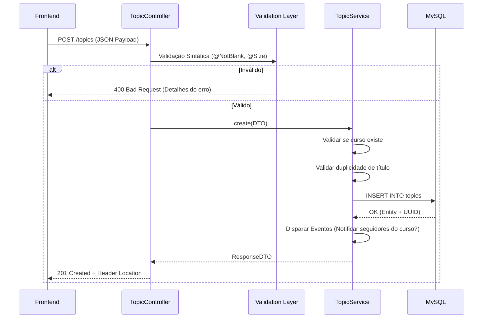
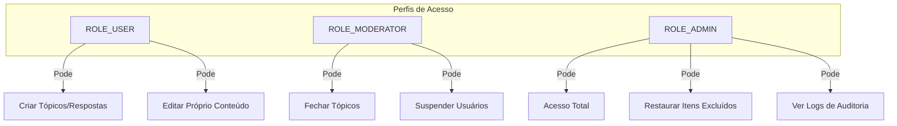

# 04 - API REST: Contratos e Fluxos de Dados

A API do FórumHub é o ponto central de comunicação. Ela foi projetada para ser **consistente**, **previsível** e **documentada**.

## 🔑 Fluxo de Criação de Recursos (Tópicos)

A criação de um tópico envolve múltiplas validações e disparos automáticos.



---

## 📡 Listagem Inteligente (Filtros e Paginação)

A listagem não apenas retorna dados, ela aplica filtros dinâmicos e cache.

| Endpoint | Parâmetros | Descrição |
| :--- | :--- | :--- |
| `GET /api/v1/topics` | `page`, `size`, `sort`, `title`, `status`, `courseId` | Lista tópicos com paginação estável. |

### Regra de Ouro da Paginação:
As páginas começam no índice **0**. Se o frontend pedir a página 1 com 10 itens, ele receberá os itens do 11º ao 20º.

---

## 🔐 Controle de Acesso Baseado em Perfis (RBAC)

Implementamos um controle granular de quem pode fazer o quê:



---

## 🛠️ Detalhes de Validação (Campos Exatos)

Para cada requisição de criação, o sistema valida:
- **Título:** Mínimo 5, máximo 100 caracteres.
- **Mensagem:** Mínimo 10, máximo 5000 caracteres.
- **Curso:** Deve ser um ID de curso ativo no sistema.

### Exemplo de Resposta de Erro de Validação (400):
```json
{
  "timestamp": "2026-01-07T18:30:00Z",
  "status": 400,
  "error": "Bad Request",
  "errors": {
    "title": "O título não pode estar em branco",
    "message": "A mensagem deve ter pelo menos 10 caracteres"
  }
}
```

---

## 📚 Documentação Swagger (OpenAPI)
Disponível em: `http://localhost:8080/swagger-ui.html`
- A documentação é gerada automaticamente a partir das anotações no código.
- Cada endpoint possui um exemplo de JSON de entrada.
- Os modelos (Schemas) descrevem cada campo, se é obrigatório e qual o seu formato (ex: UUID).