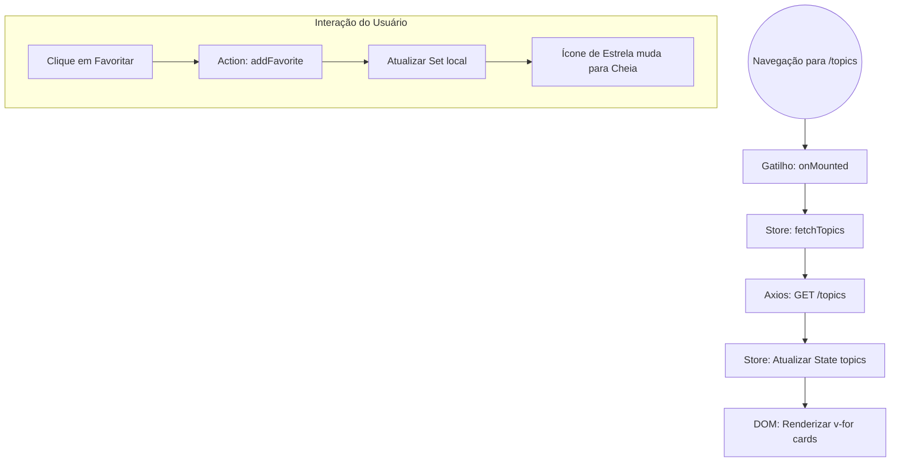
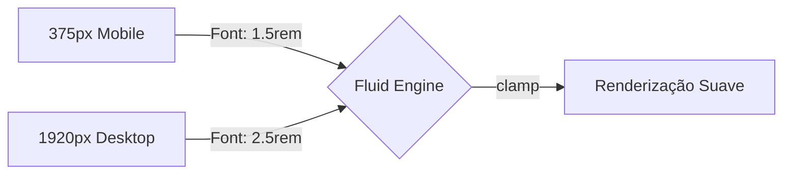

# 05 - Frontend: Arquitetura Reativa e UX

O frontend do FórumHub é uma **Single Page Application (SPA)** construída com Vue.js 3, focada em velocidade de resposta e feedback visual imediato.

## 🏗️ Fluxo de Renderização do Componente

Cada tela (View) no Vue.js segue um ciclo de vida rigoroso para garantir que os dados estejam prontos antes da interação.

---

## 💾 Gestão de Estado Centralizada (Pinia Hierarchy)

O estado da aplicação é dividido em "lojas" (stores) independentes que se comunicam quando necessário.

| Store | Responsabilidade | Dado Crítico |
| :--- | :--- | :--- |
| **AuthStore** | Sessão e Permissões | `jwt_token`, `user_roles` |
| **TopicStore** | Listagem e Paginação | `topics[]`, `totalPages` |
| **FavoriteStore** | Sincronização Global | `favoriteTopicIds (Set)` |
| **NotificationStore** | Polling e Alertas | `unreadCount` |

### Sincronização de Favoritos
Usamos um `Set` na `FavoriteStore` em vez de um Array. 
- **Por quê?** O `Set.has(id)` tem performance O(1), permitindo que, ao listar centenas de tópicos, o ícone de favorito seja renderizado instantaneamente sem atraso de busca.

---

## 🎨 Design System e Tipografia Fluida

O design **Deep Dark** utiliza cores puras para garantir o maior contraste possível em telas OLED.

### Escalonamento de Viewport (Fluidity)
Não apenas o layout é responsivo, mas as fontes e paddings também.

### Smart Buttons (Lógica de Moderação)
A visibilidade de botões como "Banir Autor" ou "Restaurar Tópico" é controlada por **Computed Properties** que verificam as Roles no `AuthStore`. Se o usuário não tem permissão, o elemento nem sequer é renderizado no DOM (`v-if`).

---

## 📡 Polling de Notificações (Implementação Técnica)

O sistema de notificações não usa WebSockets para manter a simplicidade e resiliência.

1.  **Gatilho:** O componente `TheNavbar` inicia um `setInterval` no `onMounted`.
2.  **Frequência:** A cada 30 segundos.
3.  **Ação:** Chama `notificationStore.fetchUnreadCount()`.
4.  **UX:** Se o contador mudar, o badge no ícone do sino é atualizado com uma animação de "pulse".

---

## 🛠️ Performance de Build
O `vite.config.ts` utiliza **Manual Chunking** para separar o código da aplicação das bibliotecas:
- `index.js`: Apenas a lógica do FórumHub (pequeno, carrega rápido).
- `vendor-vuetify.js`: Biblioteca de UI (pesada, cacheada permanentemente no browser).
- `vendor-vue.js`: Core do Vue e Pinia (cacheado).
