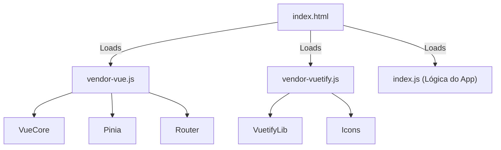

# 05 - Frontend (Vue.js 3)

O frontend do FórumHub prioriza a clareza e a eficiência, utilizando as tecnologias mais recentes do ecossistema Vue.

## 🎨 User Experience (UX)
A interface utiliza o tema **Deep Dark**, otimizando a experiência em ambientes de baixa luminosidade e seguindo padrões mobile-first.

### Design System
| Elemento | Especificação |
| :--- | :--- |
| **Paleta Principal** | Pure Black (#000000) e Sky Blue (#38BDF8) |
| **Tipografia** | Inter (ou padrão Sans-Serif moderna) |
| **Bordas** | `border-radius: 4px` em todos os botões e inputs |
| **Transições** | 150ms ease-in-out para interações de hover |

### Comportamento Responsivo
- **Mobile (< 960px):**
  - Tópicos exibidos em coluna única (full-width).
  - Botão "Novo Tópico" flutuante ou simplificado na navbar.
  - Sidebar oculta por menu hambúrguer.
- **Desktop (> 1280px):**
  - Grid de tópicos em 3 colunas.
  - Links de navegação diretos na App Bar.
  - Max-width de 1400px para evitar dispersão visual.

---

## 🏗️ Gestão de Estado (Pinia)
O estado é descentralizado em stores:
- **TopicStore:** Preserva filtros de `status`, `courseId` e `title` durante a paginação.
- **AuthStore:** Gerencia o token JWT e decodifica roles para controle de acesso visual.
- **FavoriteStore:** Mantém um `Set` local de IDs favoritados para garantir que o ícone de estrela esteja sincronizado instantaneamente entre a lista geral e a página de detalhes.
- **NotificationStore:** Realiza polling a cada 30 segundos para atualizar o contador de alertas. Ao clicar em uma notificação, marca-a como lida e navega para o tópico alvo.

---

## 🧩 Componentes Compartilhados
- **FavoriteButton:** Botão reativo que alterna o estado de favorito com feedback visual imediato.
- **NotificationBell:** Centralizador de alertas na Navbar com suporte a "Marcar todas como lidas".
- **AnimatedLogo:** Logotipo SVG otimizado com animações sutis de entrada.

---

## ⚡ Performance e Build

### Otimização de Bundles (Manual Chunking)
Para garantir um carregamento inicial rápido, o `vite.config.ts` foi configurado para dividir o código em chunks estratégicos:

Isso impede que bibliotecas pesadas (como o Vuetify) sejam rebaixadas toda vez que apenas a lógica da aplicação muda, aproveitando melhor o cache do navegador.

### Segurança
- **Integração com API:** Todas as chamadas HTTP passam por um interceptor em `src/services/api.ts` que anexa automaticamente o Token Bearer.
- **Tratamento de 401:** Redirecionamento automático para login em caso de token expirado.
