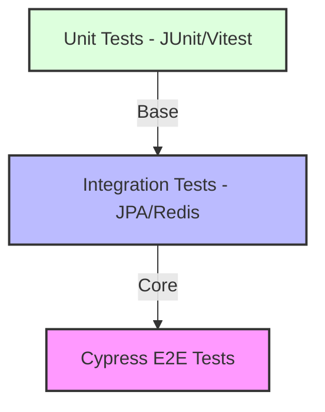
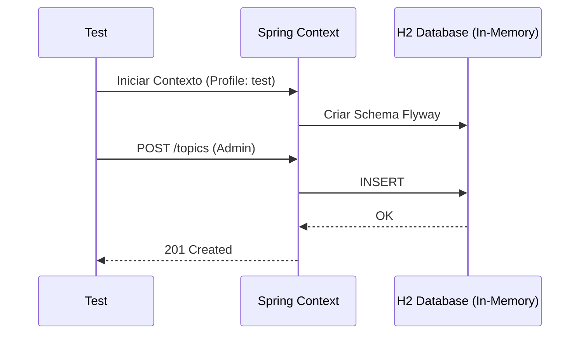
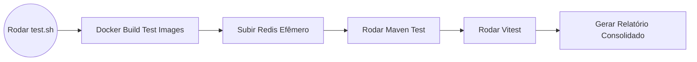

# 06 - Estratégia de Testes e Garantia de Qualidade

A qualidade do FórumHub é assegurada por uma bateria de testes automatizados que cobrem desde a menor regra de negócio até o fluxo completo do usuário.

## 📐 A Pirâmide de Testes

---

## 🧪 Testes de Backend (Spring Boot)

### 1. Testes Unitários
- **Foco:** Serviços e Regras de Negócio.
- **Ferramenta:** JUnit 5 + Mockito.
- **Exemplo:** Validar que um usuário bloqueado não pode criar um tópico.

### 2. Testes de Integração
- **Foco:** Persistência e Segurança.
- **Ferramenta:** `@SpringBootTest` com H2 Database.
- **Fluxo:**

---

## 🖥️ Testes de Frontend (Vue & Cypress)

### 1. Testes Unitários (Vitest)
- Validação de Mappers, formatadores de data e lógica das Stores.

### 2. Testes End-to-End (Cypress)
O Cypress simula um navegador real e interage com o sistema como um humano faria.

**Fluxo de Resiliência (Hardening):**
Devido à natureza assíncrona do Vue e do Docker, aplicamos estratégias de "espera inteligente":
1.  `cy.visit('/topics')`
2.  `cy.get('[data-cy="topic-card"]', { timeout: 60000 })` - Aguarda até 60s pelo carregamento do banco.
3.  `cy.contains('h1', 'Explorar Tópicos')` - Garante que o layout está estável.

---

## 🚀 Pipeline de Automação (`automation/test.sh`)

O script de teste automatiza o levantamento do ambiente para garantir isolamento.

## 📝 Notas de Implementação dos Testes
- **Profile `test`:** O backend utiliza o arquivo `application-test.yml` que configura o banco H2 como banco em memória, o que torna os testes muito rápidos.
- **Isolamento:** Cada método de teste de integração no backend utiliza `@Transactional` para garantir que o banco seja "limpado" automaticamente (Rollback) após cada execução, evitando que um teste influencie o outro.
- **Seeding:** O `DataInitializer` é desativado no perfil de teste (`@Profile("!test")`) para garantir que os dados de teste sejam controlados manualmente e previsíveis.
