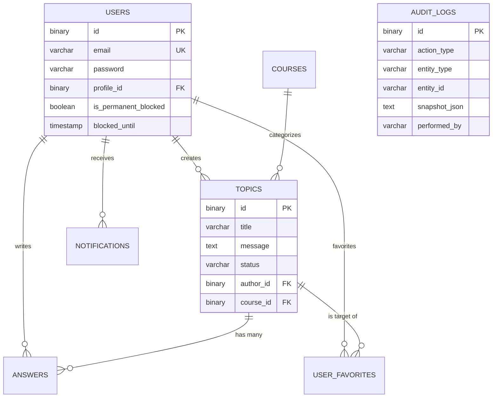

# 07 - Banco de Dados: Mapeamento e Integridade

O FórumHub utiliza o **MySQL 8.4** com um schema projetado para escalabilidade e segurança. Este documento detalha a estrutura de tabelas, índices e o gerenciamento de migrações.

## 🗄️ Modelo Entidade-Relacionamento (ERD)

Abaixo, a visualização das conexões entre as entidades core:

---

## 🏗️ Evolução do Schema (Flyway Path)

O banco de dados nunca é modificado manualmente. Cada alteração é um novo arquivo `.sql` no histórico:

---

## ⚡ Estratégia de Performance (Indexação)

Para garantir que a API responda em menos de 100ms, criamos índices específicos para as queries mais comuns:

| Tabela | Coluna Indexada | Motivação |
| :--- | :--- | :--- |
| `topics` | `created_at` | Ordenação padrão da página inicial. |
| `topics` | `status`, `course_id` | Filtros combinados na barra lateral. |
| `notifications` | `user_id`, `is_read` | Query do Polling executada a cada 30s por todos os usuários. |
| `user_favorites` | `user_id` | Carregar a lista de "Meus Favoritos". |

---

## 🔐 Segurança dos Dados

### 1. IDs Binários (UUID)
Usamos `BINARY(16)` para armazenar UUIDs. 
- **Performance:** Embora no Java vejamos strings como `550e8400...`, no MySQL elas ocupam apenas 16 bytes, metade do espaço de uma string CHAR(36), o que torna os índices extremamente compactos e rápidos.

### 2. Snapshots de Auditoria
A tabela `audit_logs` possui uma coluna de texto longo que armazena a representação JSON da entidade excluída. Isso permite que, mesmo após uma exclusão física no banco, os dados possam ser reconstruídos com 100% de fidelidade.

---

## 📝 Regras de Integridade (Constraints)
- **Cascade:** Não utilizamos `ON DELETE CASCADE` para deletar tópicos quando um usuário é excluído. Em vez disso, preservamos o conteúdo e marcamos o autor como "Usuário Excluído" para manter o histórico da comunidade.
- **Unique:** O título de um tópico é único dentro de um curso em um período de 24 horas (lógica de negócio validada no Backend).