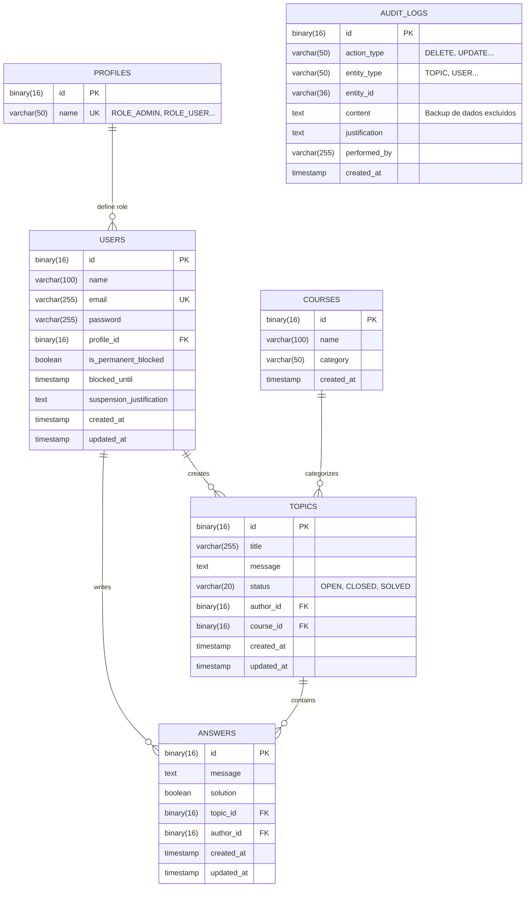

# 07 - Banco de Dados

Este documento descreve o esquema exato do banco de dados (MySQL 8) utilizado pelo FórumHub, conforme definido nas migrações Flyway.

## 🗄️ Modelo Entidade-Relacionamento (ERD)

O diagrama abaixo reflete a estrutura real das tabelas, incluindo tipos de dados e relacionamentos.

## 📜 Estrutura e Migrações (Flyway)

O banco é 100% gerenciado via Flyway. O esquema evoluiu através das seguintes versões:

### Histórico de Versões
1. **V1:** Estrutura base (`users`, `profiles`, `courses`, `topics`, `answers`, `audit_logs`).
2. **V2:** Carga inicial de dados (Perfis e Usuário Admin).
3. **V3:** Sistema de bloqueio de usuários (`is_permanent_blocked`, `blocked_until`).
4. **V4:** Auditoria e justificação de suspensão.
5. **V5:** Índices de performance (`idx_topics_author`, `idx_answers_topic`, etc).

## 🔍 Tipagem e IDs
- **UUIDs:** Todos os IDs primários são `BINARY(16)` (UUID v4) para segurança e distribuição, não inteiros sequenciais.
- **Auditoria:** A tabela `audit_logs` armazena snapshots de entidades excluídas para fins de compliance e recuperação.