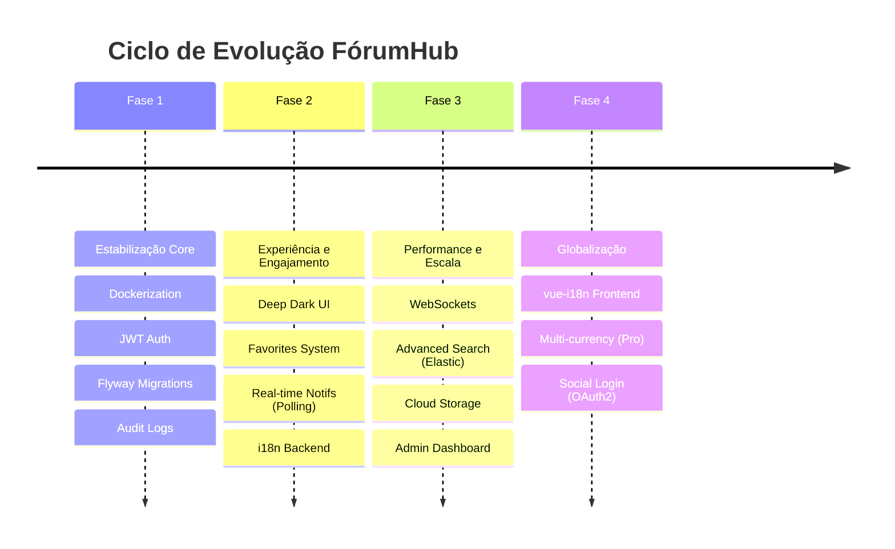

# 08 - Plano de Evolução e Roadmap

Este documento define a visão de longo prazo para o **FórumHub**, organizando as melhorias em fases lógicas de maturidade tecnológica.

## 🗺️ Roadmap Visual

---

## 📈 Melhorias Técnicas Detalhadas

### 1. Transição para WebSockets (Notificações)
- **Hoje:** Usamos Polling a cada 30s.
- **Melhoria:** Implementar **Spring WebSocket + STOMP**.
- **Ganho:** Redução drástica de chamadas HTTP inúteis e entrega de alertas instantânea (< 1s).

### 2. Busca Full-Text (Elasticsearch)
- **Hoje:** Busca via SQL `LIKE %...%`.
- **Melhoria:** Integrar a entidade `Topic` com um cluster **Elasticsearch**.
- **Ganho:** Suporte a termos aproximados, "você quis dizer?" e performance em milhões de registros.

### 3. Gerenciamento de Assets (Cloud Storage)
- **Hoje:** Sem suporte a imagens.
- **Melhoria:** Integração com **AWS S3** ou **MinIO** para armazenamento de evidências em tópicos e fotos de perfil.

---

## 🛡️ Segurança Futura
- **Rate Limit Dinâmico:** Ajustar o limite baseado na Role (ex: Admins têm limite maior).
- **2FA (Two-Factor Auth):** Implementar TOTP via Google Authenticator para contas administrativas.
