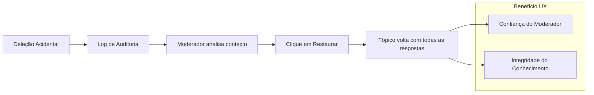

# 09 - Análise de Integração UX/Backend

O diferencial competitivo do FórumHub reside na simbiose perfeita entre a robustez do Java e a fluidez do Vue.js. Este documento analisa como escolhas de backend impulsionam a experiência do usuário.

## 🔗 Matriz de Correlação: Backend -> UX

| Escolha Técnica | Impacto Visual/UX | Por que importa? |
| :--- | :--- | :--- |
| **REST Page DTO** | Paginação Fluida | O usuário nunca espera por carregamentos massivos, a interface flui entre páginas. |
| **UUIDs Binários** | URLs Amigáveis e Seguras | O ID na URL (`/topics/550e8400...`) não revela a idade do sistema e é imutável. |
| **Audit Logs JSON** | Segurança Admin (Undo) | O Admin tem confiança para moderar, sabendo que qualquer erro pode ser revertido em 1 clique. |
| **Cache Redis L2** | Velocidade Instantânea | Tópicos populares carregam em sub-milissegundos, dando sensação de app nativo. |

---

## 🗺️ Fluxo de Valor de Auditoria (UX Perspective)

O fluxo de restauração é o "Seguro de Vida" da comunidade.

---

## 💡 Insights de Design System

### A psicologia do Deep Dark
A escolha do fundo `#000000` puro não é apenas estética. Em telas modernas, isso desliga os pixels, reduzindo o consumo de bateria em dispositivos mobile e diminuindo o cansaço visual em sessões de estudo prolongadas.

### Menus Adaptativos (Smart UI)
A lógica do backend (`AuthStore`) informa à UI exatamente quais botões exibir.
- **Exemplo:** Se o backend informa que o autor do tópico está bloqueado, o frontend desabilita o campo de resposta automaticamente, evitando que o usuário gaste tempo escrevendo para um tópico que não aceitará o envio.
